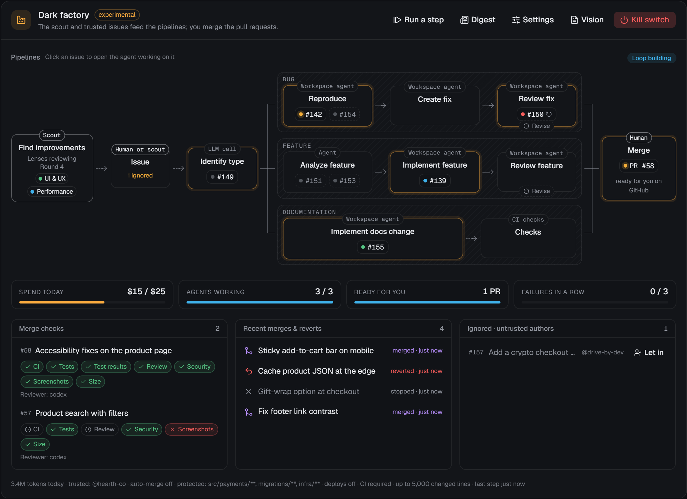

<div align="center">

# CodeDen

**One home for all your coding agents.** Start with a single agent helping you code. Run several at once, across every provider and project. When you're ready, turn your backlog over to a software factory, or let a dark factory find the work and do it on its own.

[](https://www.codeden.app)
[](https://www.npmjs.com/package/codeden)
[](LICENSE)


</div>


```sh
npx codeden
```

That's it. CodeDen opens in your browser and uses the coding agents you already have installed and signed in. There's no account to create, no license key, no cloud service and no tracking. Everything stays on your computer.

Prefer an app? **[Download the desktop app](https://github.com/leonvanzyl/codeden/releases/latest)** for Windows, macOS or Linux. It's the same CodeDen in its own window, with notifications and automatic updates, and you don't need Node.js.

---

## Contents

- [What is CodeDen?](#what-is-codeden)
- [It grows with you: four levels](#it-grows-with-you-four-levels)
- [Works with the agents you already use](#works-with-the-agents-you-already-use)
- [Everything you need in one place](#everything-you-need-in-one-place)
- [Safe by default](#safe-by-default)
- [Get started](#get-started)
- [FAQ](#faq)
- [Documentation](#documentation)
- [Contributing](#contributing) · [License](#license)

## What is CodeDen?

Coding agents like Claude Code and Codex are powerful, but they live in separate terminal windows. It's hard to keep track of what each one is doing, what it changed and what it cost, and harder still to run several of them at once without them tripping over each other.

CodeDen is the workspace around your agents. It gives every agent its own safe copy of your code and shows you what it's doing as it works. It collects every question, approval and finished pull request in one inbox. And it grows with you, from one agent to a factory that works through your issues while you do something else.

## It grows with you: four levels

You don't have to choose how big to go up front. Start small, and move up a level when you're ready. Every level keeps everything visible, so you always know what your agents did and why.

### 1. A single agent station

Open a project and start a session. You chat with an agent and watch it work. Its changes appear turn by turn, and you can see every file it touched.

- **Your code is never at risk.** Each session works in its own copy of the project on its own branch, so your own checkout is never touched.
- **Undo anything.** Every turn is saved, so you can roll files back to any earlier point.
- **Everything at hand.** The changes, the files, a terminal and a built-in browser sit next to the chat. The agent can open your app in the browser, click around and send you screenshots.
- **Plan first if you like.** On providers that support it, the agent proposes a plan and only starts changing code once you approve it.

### 2. Many stations, across providers and projects

Run as many sessions as you like, side by side, with different agents on different projects. Put Claude Code on one task and Codex on another, or ask a second agent to review the first one's work.

- **An orchestrator** you can talk to about all your projects at once ("what's going on?", "start a session to fix the login bug").
- **A project manager for each project.** It sorts incoming issues, starts sessions, keeps an eye on them and comes to you when it's unsure.
- **One inbox** for everything that needs you: questions, approvals, pull requests ready for review, failed runs and budget alerts.
- **No duplicate work.** If you start something that's already running, CodeDen asks whether to wait, skip, join or start anyway.
- **Hand off between providers.** When one agent hits its usage limit, carry on in another with the same code and a summary of the work so far.


### 3. A software factory

Turn on the software factory for a project, and the GitHub issues you file become pull requests. You file an issue, and a team of agents takes it from there:

- **Bugs** are reproduced with a failing test, fixed, and reviewed.
- **Features** are planned, built to a spec with tests, and reviewed.
- **Docs changes** are written and checked.

Every pull request comes with its test results, and screenshots when the look of the app changed. A second agent, usually on a different provider, reviews the work before it reaches you. You merge it, or switch on auto-merge and let the factory merge it for you. Only issues from people you trust are picked up.



### 4. A dark factory

A dark factory doesn't wait for you to file issues. You write down your vision for the app, and a scout regularly reviews the app against it. It files issues for what's missing or broken, and the factory builds them. You set the direction and the limits, then step away.

- **Watch it work.** The Factory view shows every agent at its station as work moves from intake to merge, as a board or as a 3D factory floor.
- **Stay in control.** Set how many agents run at once and a daily budget. Mark the areas agents must never touch. The factory pauses itself after repeated failures, and one click stops everything.
- **It learns.** Reviewers note the rules of your codebase, so later agents get them right the first time.

Both factory levels are **experimental**. Try them on a test repository first. Read [The software factory and the dark factory](docs/software-factory.md) before you start.

## Works with the agents you already use

CodeDen runs the coding agents you already have, with the logins you already have, including your subscriptions. You don't need API keys.

| Agent | What you need |
|---|---|
| [Claude Code](https://docs.claude.com/en/docs/claude-code) | `claude`, signed in with a Claude subscription or an API key |
| [Codex](https://developers.openai.com/codex/cli) | `codex`, signed in with ChatGPT or an API key |
| [OpenCode](https://opencode.ai) | `opencode` 2.2+, which can reach many more model providers, including models running on your own machine |
| [Cursor](https://cursor.com/docs/cli/overview) | The Cursor CLI (`agent`), signed in with your Cursor account |
| [Gemini CLI](https://geminicli.com) | `gemini` 0.68+, signed in with your Google account |

Mix and match freely. Each session picks its own agent and model, and the factory can build with one provider and review with another. You need at least one of them. The setup screen tells you which are ready and how to fix the rest.

## Everything you need in one place

- **Every change, visible.** See exactly what each turn changed, comment on lines and send your comments back to the agent, then commit and push from CodeDen.
- **GitHub, built in.** Agents open pull requests that link the issue and include their evidence: screenshots and test output. Review and merge without leaving CodeDen.
- **Automations.** Switch on background jobs per project, like a security audit, dependency updates, a UI review or issue triage. They run on a schedule or when something happens. Write your own in a few lines of Markdown. Everything is off until you turn it on.
- **Know what it costs.** A usage report shows tokens and cost across providers, models and projects, with daily charts, budgets and alerts. Subscription logins show what the same work would cost on the API.
- **Your agents' setup, in one editor.** Edit memory files (`CLAUDE.md`, `AGENTS.md`), skills, subagents, MCP servers and hooks for each provider. Changes go into the provider's own files, so they work in the terminal too.
- **Images for any agent.** Every agent can generate images, whatever its provider. A Claude agent building a landing page can make its own hero image.
- **Talk instead of type.** Dictate with push-to-talk, and have an agent's reply read aloud when it's done.
- **Next-step suggestions.** When an agent finishes, CodeDen suggests a few follow-up prompts you can send with one click.
- **From your phone.** Turn on network access, scan a QR code, and check on your agents from your phone or tablet.


## Safe by default

- **Private.** CodeDen runs on your computer. Your code and conversations stay there. No account, no cloud service, no tracking.
- **Locked to your machine.** Only your own computer can reach CodeDen, and every request needs a secret key unique to your install. Phone access is opt-in and password protected.
- **Risky actions ask first.** By default agents can edit and run ordinary commands in their own copy of the code. Anything risky comes to your inbox for approval first: changing files outside the project, force-pushing, deleting branches, installing software globally, or touching secrets.
- **No stored logins.** CodeDen uses your agents' and GitHub's own sign-ins and never stores them. Optional API keys go in your operating system's keychain.

Full details: [Security](docs/security.md). To report a vulnerability, see [SECURITY.md](SECURITY.md).

## Get started

**You need**

- **Node.js 24 or newer** (not needed for the desktop app)
- **git**, with your name and email set
- **At least one coding agent**, installed and signed in (see the table above)
- *Optional:* the **GitHub CLI** (`gh auth login`) for issues, pull requests and the factories
- *Optional:* **Chrome or Edge** for the built-in browser

**Run it**

```sh
npx codeden
```

Or install the **desktop app** from the [latest release](https://github.com/leonvanzyl/codeden/releases/latest): `CodeDen-Setup-<version>.exe` on Windows, a `.dmg` on macOS, an AppImage or `.deb` on Linux. If Windows or macOS warns about an unsigned app the first time, see [The desktop app](docs/desktop.md#unsigned-builds).

1. **The setup checklist** finds your agents, GitHub and git, and only asks about what's missing. Each problem has a one-click fix: an install command, or a **Sign in** button.
2. **Add a project.** Pick a folder on your computer, or paste a GitHub link to clone one.
3. **Start a session** and tell the agent what to build.


Something not working? Run `npx codeden doctor` to check your setup from the terminal. For a full walkthrough, see [Getting started](docs/getting-started.md).

CodeDen updates itself: when a new version is out, a banner offers **Update now**. Command-line options, settings files and update details are in the [Reference](docs/reference.md).

## FAQ

**Do I need API keys?**
No. CodeDen uses your agents' own logins, including Claude, ChatGPT, Cursor and Google subscriptions. API keys are only an optional extra for some image and voice features. Check your provider's terms for how your plan may be used.

**Where does my data go?**
Nowhere. It stays on your computer, in `~/.codeden/`. The only network traffic is your agents talking to their providers, GitHub (if you use it), and any optional image or voice services you turn on.

**Is there telemetry?**
No. CodeDen sends no usage data anywhere.

**Does it work without GitHub?**
Yes. Sessions, the workbench and automations all work on local folders. Issues, pull requests and the factories need GitHub.

**Will it mess up my code?**
No. Agents work in their own copies of your project on their own branches. Your own checkout and branch are never touched.

**What if I close the terminal?**
Agents in the middle of a task keep going. Run `codeden` again and it picks up where it left off. `codeden stop` stops everything.

**Which platforms does it run on?**
Windows, macOS and Linux.

**Is the dark factory safe to leave running?**
It's experimental. Start with the software factory on a test repository with auto-merge off. Set a budget, the people you trust and the areas agents must not touch, and keep the stop button in reach. See [The software factory and the dark factory](docs/software-factory.md).

## Documentation

| Guide | |
|---|---|
| [Getting started](docs/getting-started.md) | Install, setup, your first project and session |
| [The desktop app](docs/desktop.md) | Install, notifications, updates and where data lives |
| [Orchestration](docs/orchestration.md) | The orchestrator, project managers and agent sessions |
| [Workbench](docs/workbench.md) | Changes, comments, undo, forks, hand-offs, files, terminal, browser and search |
| [GitHub](docs/github.md) | Issues, pull requests, checks, reviews and evidence |
| [Automations](docs/automations.md) | Background jobs, schedules and writing your own |
| [The software factory and the dark factory](docs/software-factory.md) | Modes, pipelines, trusted authors, the scout, the vision, limits and the stop button |
| [How the factory loop works](docs/factory-loop.md) | What the factory does step by step |
| [Agent configuration](docs/agent-config.md) | Memory, skills, subagents, MCP servers and hooks |
| [Voice and images](docs/voice-and-images.md) | Dictation, read-aloud and image generation |
| [Usage and costs](docs/usage-and-costs.md) | Reports, budgets and rate limits |
| [Phones, tablets and network access](docs/remote-access.md) | Using CodeDen from your phone |
| [Security](docs/security.md) | The security model in detail |
| [Troubleshooting](docs/troubleshooting.md) | `doctor`, logs and common problems |
| [Reference](docs/reference.md) | Settings, data folder, command-line options and updates |
| [Architecture](docs/architecture.md) | How CodeDen is built |

## Contributing

Bug reports, ideas and pull requests are welcome. See [CONTRIBUTING.md](CONTRIBUTING.md) to get set up, and [CHANGELOG.md](CHANGELOG.md) for what's changed.

## License

[MIT](LICENSE) © 2026 Leon van Zyl
