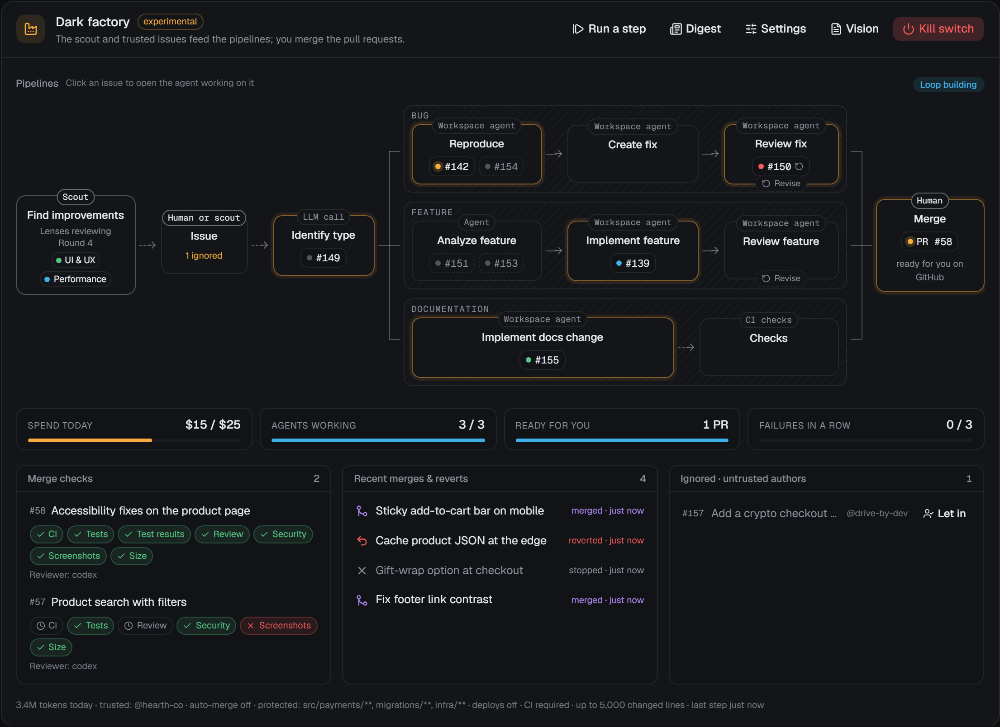

<div align="center">

# CodeDen

**A local-first harness for coding agents.** Run Claude Code, Codex, OpenCode, Cursor and Gemini CLI side by side in a calm, focused workspace, and when you're ready, let a small software factory work through your backlog while every step stays visible in GitHub.

[](https://www.codeden.app)
[](https://www.npmjs.com/package/codeden)
[](LICENSE)


</div>


```sh
npx codeden
```

That's the whole install. CodeDen starts a local server, opens your browser on an already signed-in URL, and reuses the Claude Code, Codex, OpenCode, Cursor, Gemini CLI, GitHub and git setup you already have. No accounts, no license keys, no hosted backend, no telemetry.

Prefer an app? **[Download the desktop app](https://github.com/leonvanzyl/codeden/releases/latest)** for Windows, macOS or Linux: the same CodeDen in its own window, with a tray icon, notifications and automatic updates, and no Node.js needed. See [The desktop app](docs/desktop.md).

---

## Contents

- [Quick start](#quick-start)
- [What you get](#what-you-get)
- [How it works](#how-it-works)
- [Security model](#security-model)
- [Configuration](#configuration)
- [CLI reference](#cli-reference)
- [Updating](#updating)
- [FAQ](#faq)
- [Documentation](#documentation)
- [Contributing](#contributing) · [License](#license)

## Quick start

**Requirements**

| | |
|---|---|
| **Node.js 24+** | `node --version` |
| **git** | with `user.name` and `user.email` set |
| **An agent CLI, signed in** | [Claude Code](https://docs.claude.com/en/docs/claude-code) (`claude`), [Codex CLI](https://developers.openai.com/codex/cli) (`codex`), [OpenCode](https://opencode.ai) 2.2+ (`opencode`), the [Cursor CLI](https://cursor.com/docs/cli/overview) (`agent`) and/or [Gemini CLI](https://geminicli.com) 0.68+ (`gemini`). At least one is required |
| **GitHub CLI** *(optional)* | `gh auth login` unlocks issues, pull requests, evidence and the factory. Local-only folders work without it |
| **Edge or Chrome** *(optional)* | for the browser panel and the agents' browser tools |

**Run it**

```sh
npx codeden            # or: npm i -g codeden && codeden
```

Or install the **desktop app** from the [latest release](https://github.com/leonvanzyl/codeden/releases/latest) (`CodeDen-Setup-<version>.exe` on Windows, a `.dmg` on macOS, an AppImage or `.deb` on Linux). It needs no Node.js, uses the same data as `npx codeden` (`~/.codeden`), lives in the tray and updates itself. Builds without a publisher signature show a warning the first time you open them: on Windows choose **More info › Run anyway**; on macOS open CodeDen once, then choose **Open Anyway** under **System Settings › Privacy & Security**. If macOS says the app is "damaged", see [Unsigned builds](docs/desktop.md#unsigned-builds).

1. The **setup checklist** detects Claude Code, Codex, OpenCode, Cursor, Gemini CLI, GitHub, your git identity and a browser, and only asks about what's missing. Each failed check has one fix: an install command, or a **Sign in** button that runs the tool's own login in an embedded terminal.
2. **Add a project:** pick a local folder (a server-side folder picker) or paste a GitHub URL to clone.
3. **Start a session.** The agent works in its own git worktree and branch, so your checkout is never touched.


Already installed something and want to check it? `npx codeden doctor` runs the same checks in the terminal. See [Getting started](docs/getting-started.md) for a full walkthrough.

## What you get

### Orchestrator, project managers and agent sessions

Three kinds of agents, each in its own lane:

- **Orchestrator.** One agent you talk to across every project. It creates and configures projects, hands work to project managers and summarises what's going on.
- **Project managers (PMs).** One long-lived agent per project. It triages issues, starts and steers agent sessions, follows their progress and escalates to you when it's unsure. PMs and the orchestrator are **read-only**: they never edit your code, they act through CodeDen's tools.
- **Agent sessions.** The coding agents. Each runs in its own worktree and branch, can ask you questions, request approvals, share screenshots, and finish by opening a pull request with evidence.

Every unit of work carries a **work key** (`issue:142`, `automation:security-audit`, ...), so starting something that's already running gives you a conflict card (**wait**, **skip**, **join** or **force**) instead of a silent duplicate. The orchestrator and PMs get a fresh status digest every time they wake, and session events reach them as typed **notices**. [More on orchestration](docs/orchestration.md).


### One inbox

Questions, approvals, PRs ready for review, failed runs, triage decisions, duplicate-work conflicts and budget alerts all land in one **Inbox**, each linked to its session, issue and PR and answerable in place. Toasts and (opt-in) browser notifications tell you when something new arrives, and when an agent is blocked on you a chime, a sticky toast and an amber dot on the tab icon make sure you notice.


### GitHub traceability

For projects with a GitHub remote, CodeDen syncs issues, PRs, checks and reviews using your existing `gh` login. Agents open PRs that link the issue (`Fixes #N`) and the session, and attach screenshots and test output as **evidence** that renders inline, even in private repositories. PRs ready for review come to your inbox; you can review and squash-merge from CodeDen. [GitHub guide](docs/github.md).

### Automations

Background work you switch on per project: **security audit**, **refactor sweep**, **dependency updates**, **UI review**, **test coverage gaps**, **issue triage** and **stale PR follow-up** ship as templates. Triggers are cron schedules, GitHub and session events, or manual runs; guards cover overlap, concurrency, quiet hours, daily caps and catching up after downtime. Templates are plain Markdown files with YAML frontmatter, so writing your own takes a minute. **Everything is off by default.** [Automations guide](docs/automations.md).


### A software factory, and an experimental dark factory

Each project climbs a ladder: **Manual** → **Assisted** (the default) → **Software factory** → **Dark factory**. In a **software factory**, the GitHub issues you and the people you trust file are classified as a bug, a feature or a docs change, and a pool of agents runs each through its pipeline: reproduce, fix and review a bug; analyze, implement and review a feature; change the docs. Every pull request carries its test results, and screenshots for UI changes; you merge it, or turn on auto-merge. Issues from anyone else (on a public repository, anyone at all) are ignored until you let one in, and what you let in is never merged automatically. A **dark factory** adds a scheduled scout that reviews the app against your vision with a few long-lived reviewer agents and files the issues itself. The project page draws the pipelines live: click an issue to open the agent working on it. Limits (agents at once, a daily budget, pause after repeated failures) are enforced by the server, and a kill switch stops everything with one click. Both are **experimental**. [The software factory and the dark factory](docs/software-factory.md).



### Workbench

Everything an agent touches, next to the chat:

- **Diffs and checkpoints.** Every turn is snapshotted into a hidden git ref, so you get exact per-turn and whole-session diffs and can restore files to any earlier turn. Commit and push from the git bar.
- **Diff comments.** Comment on the agent's changes line by line, then send them all back as one message. [Comment on lines](docs/workbench.md#comment-on-lines).
- **Fork a session**, or fork from an earlier turn, to try another approach with the same conversation and code while the original carries on. [Fork a session](docs/workbench.md#fork-a-session).
- **Hand a session off** to another provider (or a fresh conversation) when one hits its limit or you want a second opinion: the new session gets the same code and a brief of the work so far. [Hand a session off](docs/workbench.md#hand-a-session-off).
- **Plan mode** (Claude Code). The agent explores and proposes a plan, and only starts changing code once you approve it. [Plan mode](docs/security.md#plan-mode).
- **Files.** A file tree and a syntax-highlighted viewer for the session's worktree.
- **Terminal.** Real PTY terminals owned by the runner, so they survive server restarts.
- **Browser.** A Chromium the agents drive (navigate, snapshot, click, type, screenshot, console and network logs, plus click, hover, drag and scroll at screenshot coordinates for canvases, maps and other things without an element to pick), streamed edge to edge into the panel at the panel's own size. Click, type and scroll in it at any time.
- **Subagents** open as child threads, and the composer queues or steers while a turn runs.


[Workbench guide](docs/workbench.md).

### Agent memory, skills, subagents, MCP servers and hooks

First-class editors for each provider's **own files**: `CLAUDE.md`, `AGENTS.md`, `.claude/rules/`, Claude's auto-memory, skills, subagents, `.mcp.json`, `~/.claude.json`, `~/.codex/config.toml` and Claude's settings files. Edits are written in place with a diff preview and a backup, so they show up in the terminal CLI too, and a **What's loaded** view shows which files a session actually has in context. [Agent configuration](docs/agent-config.md).

- **Skill switches.** Turn a skill off or back on without deleting it, through Claude Code's and Codex's own settings. [Switch skills on and off](docs/agent-config.md#switch-skills-on-and-off).
- **MCP connection tests.** Check that an MCP server starts, connects and lists its tools before an agent needs it. [Test a server](docs/agent-config.md#test-a-server).
- **Hooks.** Add, edit, disable and delete Claude Code's hooks, the commands it runs before or after tool calls and on other events. [Hooks](docs/agent-config.md#hooks).

### Image generation for every agent

One `generate_image` tool, available to every agent whatever its provider. It routes to **Codex** (your existing Codex login, no API key), **Gemini** image models or **OpenAI Images**, with a daily cap and per-project overrides. A Claude agent building a landing page can make its own hero image.

### Voice

Dictate into the composer (browser speech, or ElevenLabs / OpenAI), with push-to-talk. Have an agent's final message read aloud when its turn completes, with code stripped, as a short TL;DR or the full message. [Voice and images](docs/voice-and-images.md).

### Usage and cost reports

A ledger of every turn's tokens and cost across providers, models, projects and roles, with daily charts, drill-down to sessions, top sessions, automation and factory spend, cache hit rate, cost per merged PR, CSV export, budget alerts and rate-limit windows. Subscription logins see a clearly labelled **API-equivalent cost**. [Usage and costs](docs/usage-and-costs.md).


### Follow-up prompts

When an agent finishes, CodeDen suggests two to four next prompts as one-click chips above the composer. The agent proposes them itself; a small utility model fills in when it didn't.

## How it works

```
┌──────────────────────── Web UI (React SPA) ─────────────────────────┐
│ sidebar · chat · inbox · right panels (diff/files/browser/terminal) │
└───────────────┬──────────────────────────────────────▲──────────────┘
                │ HTTP + WebSocket (127.0.0.1)          │ live events
┌───────────────▼──────────────────────────────────────┴──────────────┐
│ SERVER  (long-lived, owns all state)                                │
│  SQLite event log + projections · orchestrator and PMs · inbox      │
│  MCP endpoint (role-scoped) · automation scheduler · GitHub sync    │
└───────────────┬──────────────────────────────────────▲──────────────┘
                │ runner protocol over WebSocket        │ events + acks
┌───────────────▼──────────────────────────────────────┴──────────────┐
│ RUNNER  (separate process, next to the code)                        │
│  Claude Agent SDK · codex app-server · opencode serve · node-pty    │
│  Chromium over CDP · worktrees, checkpoints, git · MCP proxy        │
└──────────────────────────────────────────────────────────────────────┘
```

- **Two processes.** The **server** owns the database, orchestration, the inbox, automations and GitHub sync, and serves the UI. The **runner** hosts the agent processes, terminals, the browser and git. If the server restarts (an update, a crash), running agents keep going; the runner journals their events until the server is back.
- **Real SDKs and protocols.** Claude Code runs through the Claude Agent SDK using your installed `claude` binary; Codex runs through `codex app-server` over JSON-RPC; OpenCode runs as a private `opencode serve` per session, over its HTTP API and event stream; Cursor and Gemini CLI run through their Agent Client Protocol servers (`agent acp`, `gemini --acp`). No scraped terminal output.
- **Everything is an event.** Agent activity is an append-only event log in SQLite, so every action can be seen, replayed and traced to an issue, branch or PR.
- **Agents reach CodeDen through MCP.** Each session gets a role-scoped token for CodeDen's internal MCP server (`report_progress`, `ask_user`, `create_pull_request`, `attach_evidence`, the browser tools, `generate_image`, ...). Tools outside a role are never listed.

More in [Architecture](docs/architecture.md) and the full design in [docs/DESIGN.md](docs/DESIGN.md).

## Security model

- The server and runner listen on **127.0.0.1 only** by default. **Network access** for your phone or tablet is opt-in, needs a password (stored only as a salted hash), and never exposes the runner or the agents' MCP endpoint. See [Phones, tablets and network access](docs/remote-access.md).
- Every local HTTP, WebSocket and MCP request needs a **per-install random token**. The browser gets it once through the launch URL, then holds it in an HttpOnly, `SameSite=Strict` cookie.
- `Host` and `Origin` headers are checked, which blocks other websites and DNS rebinding from reaching the local API.
- Agent MCP tokens are **per session and role-scoped**, stored only as hashes, and revoked when the session ends.
- The default autonomy level, **Auto, risky actions ask**, lets agents edit and run normal commands inside their worktree, and sends risky actions to your inbox: writes outside the worktree, force pushes, branch deletion, global installs, piping downloads into a shell, and secrets access.
- Optional API keys live in the **OS keychain**, never in files. GitHub and provider logins are read from their own CLIs at runtime and never stored.

Details and how to report a vulnerability: [docs/security.md](docs/security.md) and [SECURITY.md](SECURITY.md).

## Configuration

| What | Where |
|---|---|
| Data directory | `~/.codeden/`, or `CODEDEN_HOME`, or `--home <dir>` |
| Port | `4317` by default, or `--port <n>`. The runner picks a free loopback port itself |
| Settings | **Settings** in the UI, stored in `<home>/settings.json` (non-secret) |
| Usage prices and budgets | **Usage** in the UI, stored in `<home>/usage-settings.json` |
| API keys | Settings, stored in the OS keychain |
| Per-project setup | `.codeden/project.json` in the repo: worktree setup commands and the dev server |
| Automations | `~/.codeden/automations/*.md` (all projects) and `<repo>/.codeden/automations/*.md` |
| Project vision | `<repo>/.codeden/VISION.md` (software and dark factory) |

Inside the data directory:

```
~/.codeden/
  codeden.db            SQLite database (event log + projections)
  settings.json         settings
  install-token         the per-install token (mode 600 where supported)
  server.json           running server's port and pid
  runner/               runner lock file and event journal
  wt/<project>/<id>/    agent worktrees (short paths for Windows)
  artifacts/            screenshots and files shared in chat
  orchestrator/         the orchestrator's working directory
  backups/              copies of config files taken before CodeDen overwrote them
  agent-config/         hooks you switched off on the Agents page (until you enable them)
  logs/runner.log       runner output
  deps/                 Claude Code support, installed on demand
  app/<version>/        CodeDen versions installed by one-click updates
  app/current.json      which installed version `codeden` starts
```

Two copies can run side by side with different homes and ports, for example `codeden --home ~/.codeden-test --port 4400`.

A minimal `.codeden/project.json`:

```json
{
  "setup": ["pnpm install"],
  "devServer": { "command": "pnpm dev", "port": 5173 }
}
```

## CLI reference

```
codeden [options]      Start CodeDen and open it in the browser
codeden doctor         Check the installation (--install: add Claude Code support now)
codeden update         Install the latest version and switch to it (--rollback: go back)
codeden stop           Stop the server and the runner
codeden password       Set the network access password (--generate: make one up)
codeden network on|off Let phones on your network open CodeDen, or stop it
codeden runner-link    Connect stdin/stdout to the runner in --home (run by the server
                       inside a sandbox; stdout carries only protocol frames)

Options:
  --port <n>     Port to listen on (default 4317)
  --home <dir>   Data directory (default ~/.codeden, or CODEDEN_HOME)
  --no-open      Do not open the browser
  -v, --version  Print the version
  -h, --help     Show this help
```

- Running `codeden` while it's already running prints the URL and opens it again.
- **Ctrl+C** stops the server; agents keep running in the runner. `codeden stop` stops both.
- `codeden doctor` exits non-zero when CodeDen can't run a session, and prints the one command that fixes each problem.
- Claude Code support (the Claude Agent SDK) isn't part of the package: it installs from npm into `~/.codeden/deps/` the first time it's needed, or with `codeden doctor --install`.

Environment variables: `CODEDEN_HOME` (data directory), `CODEDEN_DEBUG=1` (server log lines in the terminal), `CODEDEN_SHELL` (terminal shell; PowerShell on Windows, `$SHELL` elsewhere), `CODEDEN_GITHUB_SYNC=0` (turn GitHub polling off).

## Updating

CodeDen checks npm for a new version when it starts and every 6 hours (only the package name is sent; turn it off under **Settings > General > Updates**). When one is out, a banner says so: **What's new** shows the release notes, **Update now** installs it and restarts CodeDen, and the page reconnects on its own. Running agents are drained and resumed, the same as after any runner restart.

- **How it works.** New versions install side by side into `~/.codeden/app/<version>/`, and `~/.codeden/app/current.json` names the one to run. Whatever `codeden` you start (`npx codeden`, a global install) checks that file first and runs the newer installed version in its place, so there's nothing to reinstall by hand. The previous version is kept for rollback.
- **Install automatically.** Set **Updates** to *Install automatically* to download new versions in the background; they start the next time you open CodeDen (or right away with **Restart now**).
- **From the terminal.** `codeden update` does the same as the button (and restarts a running CodeDen); `codeden update --rollback` goes back to the previous version. `codeden doctor` lists the installed versions and which one starts.
- **Roll back** from **Settings > About** as well.
- **If it can't restart itself** (for example when started some other way), the banner says "Update installed, restart CodeDen to finish" with the command to run.
- **Running from source** (a clone of this repository) never switches versions: pull and rebuild (`git pull && pnpm install && pnpm build`).
- **The old way still works:** `npm i -g codeden@latest`, or `npx codeden@latest`. A globally installed version newer than the side-by-side one always wins.
- **Upgrading from 0.1.0:** 0.1.0 predates one-click updates; update it once by hand (`npm i -g codeden@latest` or `npx codeden@latest`).
- **The desktop app** updates itself from GitHub Releases with the same banner and the same setting; see [The desktop app](docs/desktop.md#updates).

## FAQ

**Do I need API keys?**
No. CodeDen runs your installed `claude`, `codex`, `opencode`, `agent` (Cursor) and `gemini` CLIs, which use their own logins, including claude.ai, ChatGPT, Cursor and Google subscriptions. CodeDen never implements a login of its own and never asks for a credential it can already use. API keys are an optional extra for Gemini or OpenAI image generation and cloud voice. Check your provider's terms for how your plan may be used.

**Where does my data go?**
It stays on your machine, in `~/.codeden/`. CodeDen has no account system and no hosted backend. The only network traffic is what you set up: your agents talking to their providers, GitHub (through your `gh` login), and the optional image and voice engines you enable.

**Is there telemetry?**
No. CodeDen sends no usage data anywhere.

**Does it work without GitHub?**
Yes. Local-only folders get sessions, worktrees, checkpoints, diffs, the workbench and automations; issue, PR, evidence and factory features need a GitHub remote and `gh`.

**Will it touch my working copy?**
Agent sessions work in their own worktrees under `~/.codeden/wt/` on new `codeden/...` branches. Checkpoints use hidden refs and a temporary index, so your branch and index are never touched. The orchestrator and PMs are read-only.

**What happens if I close the terminal?**
The server stops; the runner, and any agent mid-turn, keeps going. The next `codeden` reconnects and catches up. `codeden stop` stops everything.

**Which platforms?**
Windows, macOS and Linux. Windows is tested first.

**Can I use it from my phone?**
Yes. Turn on **Settings › Network access**, set a password, and scan the QR code with your phone on the same Wi-Fi (or over your own VPN such as Tailscale). The UI adapts to phones and tablets, and **Add to Home Screen** opens it full screen. Plain http addresses mean no notifications or microphone on the phone. See [Phones, tablets and network access](docs/remote-access.md).

**Is the dark factory safe to leave running?**
It's experimental. Read [The software factory and the dark factory](docs/software-factory.md) first, start with the software factory on a sandbox repository with auto-merge off, set a budget, trusted authors and protected areas, and keep the kill switch in reach.

## Documentation

| Guide | |
|---|---|
| [Getting started](docs/getting-started.md) | Install, first-run setup, first project and session |
| [The desktop app](docs/desktop.md) | Install, tray, notifications, updates, signing and where data lives |
| [Orchestration](docs/orchestration.md) | Orchestrator, PMs, agents, work keys, conflicts and notices |
| [GitHub](docs/github.md) | Issues, PRs, checks, reviews and the evidence branch |
| [Automations](docs/automations.md) | Triggers, guards, templates and writing your own |
| [The software factory and the dark factory](docs/software-factory.md) | Modes, pipelines, trusted authors, the scout, the vision file, merge checks, limits and the kill switch |
| [Workbench](docs/workbench.md) | Diffs, diff comments, checkpoints, forks, files, terminal, browser, composer, shortcuts |
| [Agent configuration](docs/agent-config.md) | Memory, skills and skill switches, subagents, MCP servers and hooks |
| [Voice and images](docs/voice-and-images.md) | Dictation, read-aloud and image generation |
| [Usage and costs](docs/usage-and-costs.md) | The ledger, reports, budgets and rate limits |
| [Phones, tablets and network access](docs/remote-access.md) | Opening CodeDen from your phone, the QR code, Add to Home Screen and VPNs |
| [Security](docs/security.md) | The security model in detail |
| [Troubleshooting](docs/troubleshooting.md) | `doctor`, logs and common issues |
| [Architecture](docs/architecture.md) | How the pieces fit, with a link to the full design |

## Contributing

Bug reports, ideas and pull requests are welcome. See [CONTRIBUTING.md](CONTRIBUTING.md) for the development setup, conventions and tests, and [CHANGELOG.md](CHANGELOG.md) for what's changed.

## License

[MIT](LICENSE) © 2026 Leon van Zyl
