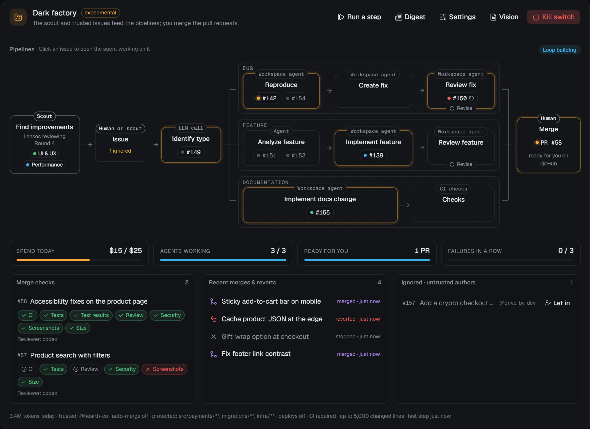

# Autonomy modes and the dark factory

> **Experimental.** Autopilot and Dark factory ship in v1 marked experimental. They merge pull requests into your default branch without you. Try them on a sandbox repository first, set a budget and protected areas, and keep the kill switch in reach. **Assisted** remains the default for every new project.

Each project has an **autonomy mode**, a ladder you climb one step at a time. (This is separate from the per-session [permission level](security.md#permissions), which decides which actions an agent must ask about.)

| Mode | Who finds work | Who merges | You |
|---|---|---|---|
| **Manual** | You | You | Drive every session. Automations only run when you (or a PM) start them: schedules and event triggers are paused |
| **Assisted** (default) | You, the PM (triage) and automations | You | Review PRs and answer the inbox |
| **Autopilot** *(experimental)* | The factory loop: new issues and failed checks on the default branch | CodeDen, when every merge check passes; anything else comes to you | Check the daily digest and handle exceptions |
| **Dark factory** *(experimental)* | The factory loop as above, plus improvement finders scored against the vision | CodeDen, when every merge check passes | Set the vision and the limits, then step away |

Change the mode from the mode picker in the project header.


## Before you switch on Autopilot or Dark factory

CodeDen refuses to switch until all three are in place:

1. **A GitHub project.** The loop works through issues, PRs and checks.
2. **A vision file**, `.codeden/VISION.md`, edited in the UI (**Vision** on the project page).
3. **Limits with a daily budget**, in USD or tokens (or both).

Strongly recommended as well:

- **CI on pull requests.** By default a repository without CI can't auto-merge (`requireCi`).
- **Branch protection** on your default branch that requires those checks.
- **An audit command** (for example `pnpm audit --prod`) for the security check.
- **Protected areas** for anything you never want merged without you.

## The vision file

The factory scores every candidate against `.codeden/VISION.md`, and its agents get the text in their prompts. It's plain Markdown: `##` headings are sections, bullets under them are the entries. Unknown sections are ignored.

```markdown
# Vision

A tiny, dependable arithmetic library for scripts.

## Goals
- Cover the common numeric helpers people reach for in scripts
- Zero runtime dependencies

## Target users
- Script authors who want small, obvious helpers

## Principles
- Small, well-tested changes
- Keep the public API stable

## Out of scope
- Big-number or arbitrary-precision maths
- A CLI

## Quality bar
- Every behaviour change comes with tests
- CI is green before merge

## Protected areas
- `**/auth/**`
- `**/migrations/**`
- `.github/workflows/**`
- `LICENSE`
- payments
- licensing
```

Recognised sections: **Goals**, **Target users** (or Users, Audience), **Principles** (or Values), **Out of scope** (or Non-goals), **Quality bar** and **Protected areas**. If the file is missing, the editor starts from a template like the one above.


### Protected areas

Anything here **always comes to you**; the factory never merges a change that touches it.

- **Paths:** anything in backticks is a glob (`` `**/auth/**` ``, `` `LICENSE` ``). Bare entries that look like paths (contain `/` or `*`, or look like a file name) are treated as globs too.
- **Topics:** plain words such as `payments` or `licensing`. A topic is matched as a word in the PR title and description, and well-known topics also protect their usual paths:

| Topic | Also protects |
|---|---|
| `auth`, `authentication` | `**/auth/**`, `**/*auth*.*` |
| `payments`, `billing` | `**/payment*/**`, `**/billing/**`, `**/*payment*.*`, `**/*billing*.*` |
| `migrations`, `data migrations` | `**/migrations/**`, `**/*migration*.*` |
| `infrastructure`, `infra` | `**/infra/**`, `**/terraform/**`, `**/*.tf`, `.github/workflows/**` |
| `licensing`, `license` | `LICENSE`, `LICENSE.*`, `COPYING` |

You can add more globs in the **Limits** dialog (**Protected paths**), on top of the vision's. The vision file itself and deploy files are always protected (see below).

## The factory loop

The loop is a server-side state machine, ticked every 30 seconds and whenever a factory session or PR changes. It survives restarts. Each step:

1. **Discover.** New issues (opened after you enabled the mode, or labelled `codeden-factory`) and failed checks on the default branch become candidates. In **Dark factory**, when the backlog runs low, **improvement finders** also run: agent sessions that look for work in one area at a time (`features`, `ux`, `performance`, `tech_debt`, `test_gaps`, `security`), round-robin, and report candidates grounded in the vision.
2. **Prioritise and plan.** The PM is woken to triage candidates against the vision. Accepted items get a GitHub issue with a work key and acceptance criteria, so the factory's backlog is visible and editable by you on GitHub.
3. **Build.** Agent sessions implement the best-scored items (work key `issue:<n>`), with the usual duplicate checks.
4. **Verify.** The merge checks below run on each PR.
5. **Merge.** Squash merge, then a comment on the issue.
6. **Watch.** CI on the merge commit is watched. A failure opens an **automatic revert PR** (which goes through the same checks), **pauses the loop** and raises a high-priority inbox item.
7. **Report.** Once a day, a **digest**: what shipped, what was rejected or failed and why, the decisions the factory made on its own, spend against the budget, and what's waiting on you. It lands in your inbox and is sent to the orchestrator.

Factory work is ordinary sessions, issues and PRs, so all of it stays traceable.

### Nobody waits on you in Dark factory

In **Dark factory**, the project's PM and the factory's own sessions (finders, builders, reviewers) never stop to ask you something. If one of them asks, through CodeDen's `ask_user` or the agent's own question tool, it gets an immediate answer instead: decide from the vision and carry on.

- **The vision wins over the current code.** If the code doesn't match the vision (say the vision names a different stack), the work that brings it in line comes first. Work it would throw away waits.
- **Decisions are recorded.** The agent records each judgement call with `factory_record_decision`: the question, what it decided and why. It arrives in your inbox as a low-priority **Factory decided** message and in the daily digest. To change one, tell the project manager or edit the vision.
- **Flagged decisions:** a protected area, a missing or self-contradicting vision, or anything irreversible outside the code (deploys, releases, data, money) is flagged as **Factory needs you**, at high priority. The factory still doesn't wait: it carries on with everything that doesn't depend on that decision.

Sessions you start yourself in a Dark factory project still ask you as usual, and so does the PM when you're talking to it directly. In **Autopilot**, questions still reach you, since exceptions are yours to handle there.

## Merge checks

Every check must pass before an automatic merge. Results are recorded per item and shown in the factory panel.

| Check | Passes when |
|---|---|
| **Protected areas** | No changed path matches a protected glob, the vision file or a deploy file, and no protected topic is mentioned. A failure escalates to a PR review in your inbox |
| **Size** | The change is within `maxChangedLines` (default 800 added + deleted) and `maxChangedFiles` (default 40) |
| **CI** | The PR's checks are green. Missing CI fails after a grace period unless `requireCi` is off |
| **Review** | An **independent reviewer session**, on a different provider from the builder when one is available, approves against the acceptance criteria and the vision |
| **Tests** | Test files changed (or the change is only docs or config), and the reviewer agrees the tests the change needs exist |
| **Security** | Your `auditCommand`, run in the builder's worktree, passes, and the reviewer raised no security concerns |
| **UI evidence** | If UI files changed, screenshots were attached with `attach_evidence` |

When a check fails, the builder gets up to `maxFixAttempts` fix rounds (default 1); after that the item fails and counts towards the pause limit.

## Limits

Limits are **required** and **enforced by the server**, never left to agent judgement.

| Limit | Default | Effect |
|---|---|---|
| Daily budget (USD and/or tokens) | required | The loop pauses until the next day when today's spend reaches it |
| Sessions at once (`maxConcurrentSessions`) | 2 | Factory sessions holding a slot |
| Merges per day (`maxMergesPerDay`) | 5 | Also caps the builds in flight |
| Pause after failures (`pauseAfterConsecutiveFailures`) | 3 | Failed merge checks or reverts in a row pause the loop |
| Protected paths | none | Added to the vision's protected areas |
| Allow deploy and release changes (`allowDeploys`) | off | While off, deploy files (`.github/workflows/*deploy*`, `*release*`, `*publish*`, `Dockerfile`, `fly.toml`, `vercel.json`, `netlify.toml`) are protected |

**Tuning** (the **Limits** dialog covers `requireCi`, `maxChangedLines` and `auditCommand`; the rest is set through the API's `tuning` field, see [API](#api)):

| Setting | Default |
|---|---|
| `requireCi` | `true` |
| `maxChangedLines` / `maxChangedFiles` | `800` / `40` |
| `auditCommand` | none |
| `maxFixAttempts` | `1` |
| `minBacklog` (Dark factory: discover when fewer items wait) | `2` |
| `discoveryIntervalMin` / `discoveryPerRound` | `360` / `2` |
| `areas` | all six discovery areas |
| `builderProvider` | `auto` (the agent role default) |
| `watchTimeoutMin` (wait for CI on main after a merge) | `120` |

Spend comes from the same ledger as the [usage reports](usage-and-costs.md).

## The factory panel

The project page shows the factory panel when a factory mode is on:

- the loop stage (Discover, Build, Verify, Merge & watch) and state;
- meters for **spend today**, **merges today**, **sessions** and **failures in a row**;
- **In progress and backlog**, **Merge checks** per PR, and **Recent merges and reverts**;
- today's digest;
- buttons: **Run a step**, **Digest**, **Limits**, **Vision** and the **Kill switch**.

Click any item for its details: where it came from, its issue, PR and sessions, and every merge-check result.



## The kill switch

- **Per project:** **Kill switch** on the factory panel.
- **Global:** **Settings → General → Global factory kill switch** stops every project's loop.

One click stops the loop and **every factory session**; items that were building go back to the backlog. The loop stays stopped until you turn the switch off. A kill switch never hands work back to automations, so issues don't suddenly start getting triaged the old way while the factory is stopped.

When the loop **pauses** by itself (budget, repeated failures, a revert), resume it from the panel once you've looked at the reason; that also clears the failure count.

## How the factory and automations share work

In Autopilot and Dark factory the loop is the only intake for issues. Automations triggered by new or labelled issues that would triage or start a session are recorded as skipped (`factory_intake`), so an issue is never taken on twice. Scheduled automations (security audit, dependency updates, ...) keep running alongside the loop, and their PRs are reviewed by you as usual. In Manual and Assisted the loop is idle.

## Warnings

- **It merges to your default branch.** Merge checks reduce risk; they don't remove it. Use branch protection and real CI.
- **It spends real money or quota.** Set a daily budget you're comfortable losing on a bad day; subscription users spend their plan's limits.
- **Agents can be wrong in confident ways.** The independent reviewer and tests help, but read the daily digest and spot-check merged PRs.
- **Protected areas are your safety net.** Put auth, payments, data migrations, infrastructure and licensing there.
- **No deploys by default.** Leave `allowDeploys` off unless deploying is a separate, deliberate automation.
- **Start small.** Autopilot on a sandbox repository, a low budget, one session at a time, then climb.

## API

Everything in the UI is also available over the local API (with the install token as a bearer token):

| Route | |
|---|---|
| `GET /api/projects/:id/factory` | Panel status |
| `PUT /api/projects/:id/autonomy` | `{ mode, limits?, tuning? }` |
| `GET` / `PUT /api/projects/:id/vision` | Read or write the vision |
| `POST /api/projects/:id/kill-switch`, `POST /api/factory/kill-switch` | `{ on: true }` |
| `POST /api/projects/:id/factory/resume` | Clear a pause |
| `POST /api/projects/:id/factory/tick` | Run one step now |
| `POST /api/projects/:id/factory/digest` | Today's digest now |

For example, to tune a running Autopilot project:

```sh
TOKEN=$(cat ~/.codeden/install-token)
curl -X PUT http://127.0.0.1:4317/api/projects/<projectId>/autonomy \
  -H "authorization: Bearer $TOKEN" -H "content-type: application/json" \
  -d '{"mode":"autopilot","tuning":{"maxFixAttempts":2,"auditCommand":"pnpm audit --prod"}}'
```
