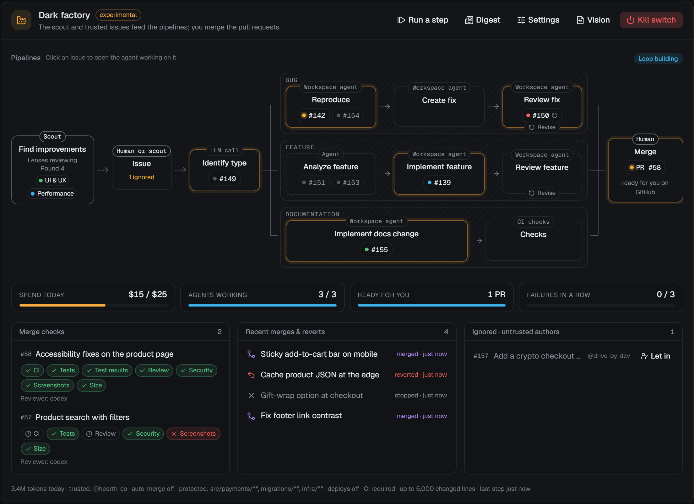

# The software factory and the dark factory

> **Experimental.** Both factory modes are marked experimental. Try them on a sandbox repository first, set a budget and protected areas, and keep the kill switch in reach. **Assisted** remains the default for every new project.

Each project has an **autonomy mode**, a ladder you climb one step at a time. (This is separate from the per-session [permission level](security.md#permissions), which decides which actions an agent must ask about.)

| Mode | Who finds work | Who merges | You |
|---|---|---|---|
| **Manual** | You | You | Drive every session. Automations only run when you (or a PM) start them: schedules and event triggers are paused |
| **Assisted** (default) | You, the PM (triage) and automations | You | Review PRs and answer the inbox |
| **Software factory** *(experimental)* | You and the people you trust, as GitHub issues | You, or CodeDen when you turn on **auto-merge** | File issues, review the pull requests |
| **Dark factory** *(experimental)* | The software factory's sources, plus a scheduled **scout** that reviews the app against the vision | As above | Set the vision and the limits, then step away |

Change the mode from the mode picker in the project header.

## How the software factory works

Issues are created outside CodeDen: by you, a teammate, or anything that files GitHub issues. The factory takes them from there:

```
                       ┌─ Bug:      Reproduce ─► Create fix ─► Review fix ─┐
Issue ─► Identify type ┼─ Feature:  Analyze ───► Implement ──► Review ─────┼─► Merge
                       └─ Docs:     Implement docs change ─────────────────┘
                                               ▲               │
                                               └─── Revise ────┘
```

1. **Issue.** A new issue on GitHub (opened after you switched the mode on, or labelled `codeden-factory`) becomes a work item. Only issues by [trusted authors](#who-the-factory-works-for) are taken on.
2. **Identify type.** One call to the [utility model](usage-and-costs.md) classifies it as a **bug**, a **feature** or a **docs** change. A GitHub label settles it without a model call (`bug`, `enhancement`/`feature`, `documentation`/`docs`); with no model available, keywords decide. The factory labels the issue (`factory:bug`, `factory:feature`, `factory:docs`) and comments which pipeline it goes down.
3. **A free agent takes it.** The server is the orchestrator of the swarm: it hands queued items to agents as slots free up, within **Agents at once** (`maxConcurrentSessions`). A fix for a failing check on the default branch goes first, then the issues you and trusted authors filed, oldest first, then the issues the [scout](#the-dark-factory) filed, by the priority it gave them. Each item gets its own agent session in its own worktree.
4. **The pipeline runs.**
   - **Bug: Reproduce.** The agent writes a failing test (or a probe) that shows the bug and reports it with `factory_report_reproduction`. A bug that doesn't reproduce stops here, with a comment on the issue asking for what's missing.
   - **Bug: Create fix.** The same agent makes the failing test pass and keeps it as a regression test.
   - **Feature: Analyze.** The agent checks whether the request already works, fits the vision and the architecture, and writes a spec with acceptance criteria (`factory_submit_analysis`). The spec is posted on the issue. A request that is already possible, unclear or out of scope stops here with a comment.
   - **Feature: Implement.** The same agent builds it to the spec, with tests and docs.
   - **Docs: Implement docs change.** No reproduction, no analysis, and no agent review as long as the change touches only documentation.
5. **Review.** An **independent reviewer session**, on a different provider from the author when one is available, checks the pull request against the issue, the spec and the vision. `request_changes`, or any failed merge check, sends the work back to the author: the **revise loop** (up to `maxFixAttempts` rounds, default 2).
6. **Merge.** With every check green the pull request is **ready for you**: an inbox item, a comment on the PR, and the item waits at Merge until you merge it on GitHub. With **auto-merge** on, CodeDen squash-merges trusted work itself and watches CI on the default branch afterwards (a regression opens an automatic revert PR and pauses the loop).

Every pull request carries its **test results** (a `## Test results` section in the description, or the raw output attached with `attach_evidence`) and, when UI files changed, **screenshots**. Both are merge checks.

### The pipeline on the dashboard

The project page shows the factory panel with the pipelines drawn as a live diagram. Every work item sits on the node of its current step, and **clicking it opens the agent session working on it** (or the item, before an agent has it). A dashed chip is waiting for a free agent; a circular arrow marks work in a revise round; a shield marks work let in from an untrusted author.



Under the diagram: spend against the daily budget, agents working out of the limit, pull requests ready for you (or merges today with auto-merge), the failure streak, merge checks per PR, recent results, and the issues ignored because of their author.

### Finished work cleans up after itself

Once a work item is finished (merged, reverted, rejected or failed), the factory [archives](workbench.md#archiving-and-worktree-cleanup) its sessions: the builder and its reviewers leave the sidebar and their worktrees are removed, so a busy factory fills neither your session list nor your disk. Nothing is lost. The branch, the checkpoints and the transcript stay, archived sessions are under the project's **Archived** filter, clicking the item on the panel still opens its session, and messaging an archived session brings it back with its worktree. A worktree with uncommitted changes is kept, as with any archive.

Work that isn't finished keeps its sessions: a pull request escalated to you, a merge whose CI on the default branch is still being watched, and an item that failed only on the size limit while its pull request is open (the PM may still allow it). A session still finishing a turn is never cut off; it is archived once the turn ends. After a **Retry**, the earlier attempt's sessions are archived the same way, unless they were archived already. The factory archives an item's sessions only once, so a session you unarchive stays, even through a retry. The scout and its area reviewers are long-lived and never archived this way.

## Who the factory works for

On a public repository anyone can open an issue, and an issue is a prompt for a coding agent. So the factory only takes on issues by **trusted authors**:

- the GitHub account CodeDen uses (the one `gh` is signed in as), always;
- the logins you list in **Trusted authors** in the factory settings.

Everyone else's issues are **ignored**: listed under *Ignored · untrusted authors* on the panel, with no model call, no agent and no comment on them. Labels don't count as trust (issue templates can apply labels for anyone). If you add the author to your trusted list later, their open issues are taken on.

To take on one of them anyway, click **Let in** on the panel or the item page, or ask the PM to (`factory_admit_issue`; the PM is told to do this only when you ask, never because an issue or a comment asks). Work let in that way runs through its pipeline like any other, **but it is never merged automatically**, whatever the auto-merge setting says: a person merges it.

Other guards:

- The factory never merges, reviews or acts on pull requests other people open. It only merges pull requests its own agents opened for its work items.
- Issue text and comments reach agents as data, with instructions to ignore anything in them that asks for secrets, CI or deploy changes, unknown hosts, or work outside the repository.
- Only evidence comments posted by the account CodeDen uses count as test output or screenshots.

## The dark factory

A dark factory adds a **scout**: a long-lived agent that finds the work itself, so you can step back.

When fewer than `minBacklog` items (default 2) wait for an agent and `discoveryIntervalMin` (default 6 hours) has passed since its last round, the scout runs a **review round**:

1. **Plan.** The scout looks at the app against the vision (what changed since its last round, what is open) and asks for at most **Review areas per round** (`discoveryPerRound`, default 2) review areas with `factory_plan_round`, each with a focus specific to this app.
2. **Review.** Each review area gets an **area reviewer**: a long-lived reviewer agent focused on one area of the app (UI and UX, performance, security, features, bugs, code quality, test gaps or docs). Each reports findings with `factory_report_findings`.
3. **File.** The scout decides against the vision what is worth doing, merges duplicates, and files at most **Issues per round** (`maxIssuesPerRound`, default 3) as GitHub issues with `factory_file_issue`, already typed. They enter the pipelines like any trusted issue.

The rules that keep it cheap are enforced by the server, not left to the agents:

- **One scout and at most one area reviewer per review area, ever.** They are long-lived: the next round sends them a message instead of starting new sessions, so they keep what they learned and don't re-read the codebase.
- **At most `discoveryPerRound` review areas per round**, however many the scout asks for, and only as many as there are free agent slots: builders and reviewers come first. The scout ends its turn once it has planned, so its own slot goes to an area reviewer. When an area gets no reviewer, `factory_plan_round` tells the scout why (not an allowed area, asked for twice, over the round's limit, or no free slot under **Agents at once**).
- **A round only starts when the queue runs low** and the interval has passed; at most `maxIssuesPerRound` issues come out of it; a round that runs over three hours is closed.
- The scout and its area reviewers hold agent slots and count against the daily budget like every other factory session.

### Nobody waits on you in a dark factory

In a dark factory, the project's PM and the factory's own sessions (the scout, its area reviewers, builders, reviewers) never stop to ask you something. A question, through CodeDen's `ask_user` or the agent's own question tool, gets an immediate answer instead: decide from the vision and carry on. An **approval** (a risky action under its permission level) is **denied** at once, never approved, with the same guidance.

- **The vision wins over the current code.** Work that brings the code in line with the vision comes first.
- **Decisions are recorded.** Each judgement call goes through `factory_record_decision` to your inbox as a low-priority **Factory decided** message and into the daily digest.
- **Flagged decisions:** a protected area, a missing or self-contradicting vision, or anything irreversible outside the code is flagged as **Factory needs you**, at high priority, without stopping the rest.

Sessions you start yourself still ask you as usual, and so does the PM when you talk to it. In the software factory, questions reach you, since exceptions are yours to handle.

## Before you switch a factory on

CodeDen refuses to switch until all three are in place:

1. **A GitHub project.** The factory works through issues, pull requests and checks.
2. **A vision file**, `.codeden/VISION.md`, edited in the UI (**Vision** on the project page).
3. **A daily budget**, in USD or tokens (or both).

Strongly recommended as well:

- **CI on pull requests.** By default a repository without CI fails the CI check (`requireCi`).
- **Branch protection** on your default branch that requires those checks.
- **An audit command** (for example `pnpm audit --prod`) for the security check.
- **Protected areas** for anything you never want changed without you.
- **Auto-merge off** until you trust what the factory ships.

## The vision file

Agents get the vision in their prompts, the analyzer checks feature requests against it, and the scout finds work with it. It's plain Markdown: `##` headings are sections, bullets under them are the entries. Unknown sections are ignored.

```markdown
# Vision

A tiny, dependable arithmetic library for scripts.

## Goals
- Cover the common numeric helpers people reach for in scripts
- Zero runtime dependencies

## Target users
- Script authors who want small, obvious helpers

## Principles
- Small, well-tested changes
- Keep the public API stable

## Out of scope
- Big-number or arbitrary-precision maths
- A CLI

## Quality bar
- Every behaviour change comes with tests
- CI is green before merge

## Protected areas
- `**/auth/**`
- `**/migrations/**`
- `.github/workflows/**`
- `LICENSE`
- payments
- licensing
```

Recognised sections: **Goals**, **Target users** (or Users, Audience), **Principles** (or Values), **Out of scope** (or Non-goals), **Quality bar** and **Protected areas**. If the file is missing, the editor starts from a template like the one above.


### Protected areas

Anything here **always comes to you**: a pull request that touches it is escalated (**Needs you**) and never merged automatically.

- **Paths:** anything in backticks is a glob (`` `**/auth/**` ``, `` `LICENSE` ``). Bare entries that look like paths (contain `/` or `*`, or look like a file name) are treated as globs too.
- **Topics:** plain words such as `payments` or `licensing`. A topic is matched as a word in the PR title and description, and well-known topics also protect their usual paths:

| Topic | Also protects |
|---|---|
| `auth`, `authentication` | `**/auth/**`, `**/*auth*.*` |
| `payments`, `billing` | `**/payment*/**`, `**/billing/**`, `**/*payment*.*`, `**/*billing*.*` |
| `migrations`, `data migrations` | `**/migrations/**`, `**/*migration*.*` |
| `infrastructure`, `infra` | `**/infra/**`, `**/terraform/**`, `**/*.tf`, `.github/workflows/**` |
| `licensing`, `license` | `LICENSE`, `LICENSE.*`, `COPYING` |

You can add more globs in the factory settings (**Protected paths**), on top of the vision's. The vision file itself and deploy files are always protected (see below).

## Merge checks

Every check must pass before a pull request is ready to merge. Results are recorded per item and shown on the panel and the item page.

| Check | Passes when |
|---|---|
| **Protected areas** | No changed path matches a protected glob, the vision file or a deploy file, and no protected topic is mentioned. A failure escalates the PR to you |
| **Size** | The change is within **Largest change** (`maxChangedLines`, default 5,000 added + deleted lines) and **Most files changed** (`maxChangedFiles`, no limit by default). Lockfiles and generated or vendored files don't count. The PM can allow a bigger change that can't be split |
| **CI** | The PR's checks are green. While the PR has merge conflicts it waits for the builder to rebase (GitHub runs no CI on a conflicting PR). No checks on the head commit wait 10 minutes from when that head appeared, then fail with "CI never started", unless `requireCi` is off |
| **Review** | The independent reviewer approves against the issue, the spec and the vision. Skipped for docs-only changes in the docs pipeline |
| **Tests** | Test files changed (or the change is only docs or config), and the reviewer agrees the tests the change needs exist |
| **Test results** | The PR description has a `## Test results` section, or test output was attached with `attach_evidence`. Skipped when no code changed |
| **Security** | Your `auditCommand`, run in the builder's worktree, passes, and the reviewer raised no security concerns |
| **Screenshots** | If UI files changed, screenshots were attached with `attach_evidence` |

A failed check (other than size) starts a **revise round**: the builder gets the failures and fixes them in the same branch, up to `maxFixAttempts` rounds; after that the item fails and counts towards the pause limit. CI that never started is no code problem, so on its own it fails the item without a revise round. A review verdict that arrives after a revise round started goes to the builder as part of that round; one that arrives after the item failed is kept on the item.

**Merge conflicts are the factory's own job.** When another merge leaves a PR conflicting with the default branch, the builder is asked to rebase onto it and resolve the conflicts. That isn't a revise round. It is asked again while the conflicts remain, up to three times, and only then does the item fail. CI is then awaited on the rebased head, and a review already given still counts. If cleanup archived the builder in the meantime, the request brings it and its worktree back. The audit (`auditCommand`) only runs in the builder's worktree once it is there again and the builder is between turns. Until then the audit is pending, and it is still required before a merge.

**Too large is different.** A revise round can't make work smaller without cutting scope, so a size failure skips it and doesn't count towards the pause limit. Instead the PM is woken to split the work into smaller issues, or, when it can't be split (an initial scaffold, a stack migration), allow it with `factory_allow_large_change`.

## Settings and limits

Settings are **enforced by the server**, never left to agent judgement. Open them with **Settings** on the factory panel.

| Setting | Default | Effect |
|---|---|---|
| Merge automatically (`autoMerge`) | off | Off: every PR waits for you. On: trusted work merges once every check passes. Work let in from an untrusted author always waits |
| Trusted authors (`trustedAuthors`) | none | GitHub logins whose issues are taken on, besides the account CodeDen uses |
| Daily budget (USD and/or tokens) | required | The loop pauses until the next day when today's spend reaches it |
| Agents at once (`maxConcurrentSessions`) | 2 | The swarm: builders, reviewers, the scout and its area reviewers share it |
| Auto-merges per day (`maxMergesPerDay`) | 5 | With auto-merge on, also caps the builds in flight |
| Pause after failures (`pauseAfterConsecutiveFailures`) | 3 | Failed merge checks or reverts in a row pause the loop |
| Protected paths | none | Added to the vision's protected areas |
| Allow deploy and release changes (`allowDeploys`) | off | While off, deploy files (`.github/workflows/*deploy*`, `*release*`, `*publish*`, `Dockerfile`, `fly.toml`, `vercel.json`, `netlify.toml`) are protected |

**Tuning** (the merge-check and scout sections of the settings cover the common ones; the rest is set through the API's `tuning` field):

| Setting | Default |
|---|---|
| `requireCi` | `true` |
| `maxChangedLines` / `maxChangedFiles` | `5000` / no limit (`null` turns either off) |
| `auditCommand` | none |
| `maxFixAttempts` (revise rounds) | `2` |
| `minBacklog` (dark factory: scout when fewer items wait) | `2` |
| `discoveryIntervalMin` (dark factory: minutes between rounds) | `360` |
| `discoveryPerRound` (dark factory: review areas per round) | `2` |
| `maxIssuesPerRound` (dark factory: issues per round) | `3` |
| `areas` (dark factory: the review areas the scout may use) | all eight |
| `builderProvider` | `auto` (the agent role default) |
| `watchTimeoutMin` (wait for CI on main after an automatic merge) | `120` |

Spend comes from the same ledger as the [usage reports](usage-and-costs.md).

## The kill switch

- **Per project:** **Kill switch** on the factory panel.
- **Global:** **Settings → General → Global factory kill switch** stops every project's loop.

One click stops the loop and **every factory session** (builders, reviewers, the scout, its area reviewers); items that were building go back to the queue. The loop stays stopped until you turn the switch off. A kill switch never hands work back to automations.

When the loop **pauses** by itself (budget, repeated failures, a revert), resume it from the panel once you've looked at the reason; that also clears the failure count.

## How the factory and automations share work

In both factory modes the loop is the only intake for issues. Automations triggered by new or labelled issues that would triage or start a session are recorded as skipped (`factory_intake`), so an issue is never taken on twice. Scheduled automations (security audit, dependency updates, ...) keep running alongside the loop, and their PRs are reviewed by you as usual. In Manual and Assisted the loop is idle.

## Warnings

- **Auto-merge merges to your default branch.** Merge checks reduce risk; they don't remove it. Use branch protection and real CI, and start with auto-merge off.
- **It spends real money or quota.** Set a daily budget you're comfortable losing on a bad day; subscription users spend their plan's limits.
- **Agents can be wrong in confident ways.** The reproduction, the analysis, the independent reviewer and tests help, but read the daily digest and spot-check what ships.
- **Protected areas are your safety net.** Put auth, payments, data migrations, infrastructure and licensing there.
- **Keep your trusted-author list short.** Everyone on it can make the factory spend your budget.

## API

Everything in the UI is also available over the local API (with the install token as a bearer token):

| Route | |
|---|---|
| `GET /api/projects/:id/factory` | Panel status (items with their pipeline step, ignored issues, the scout) |
| `PUT /api/projects/:id/autonomy` | `{ mode, limits?, tuning? }` (`mode`: `software_factory` or `dark_factory`; the old `autopilot` still reads as `software_factory`) |
| `GET` / `PUT /api/projects/:id/vision` | Read or write the vision |
| `POST /api/projects/:id/factory/admit` | `{ itemId, type? }`: let an ignored issue in |
| `POST /api/projects/:id/factory/set-type` | `{ itemId, type, reason? }`: move an item that hasn't started to another pipeline |
| `POST /api/projects/:id/factory/items/:itemId/retry` | Run a stopped item again |
| `POST /api/projects/:id/kill-switch`, `POST /api/factory/kill-switch` | `{ on: true }` |
| `POST /api/projects/:id/factory/resume` | Clear a pause |
| `POST /api/projects/:id/factory/tick` | Run one step now |
| `POST /api/projects/:id/factory/digest` | Today's digest now |

For example, to switch a project to the software factory with auto-merge on and one teammate trusted:

```sh
TOKEN=$(cat ~/.codeden/install-token)
curl -X PUT http://127.0.0.1:4317/api/projects/<projectId>/autonomy \
  -H "authorization: Bearer $TOKEN" -H "content-type: application/json" \
  -d '{"mode":"software_factory","limits":{"dailyBudget":{"usd":10},"autoMerge":true,"trustedAuthors":["my-teammate"]}}'
```
