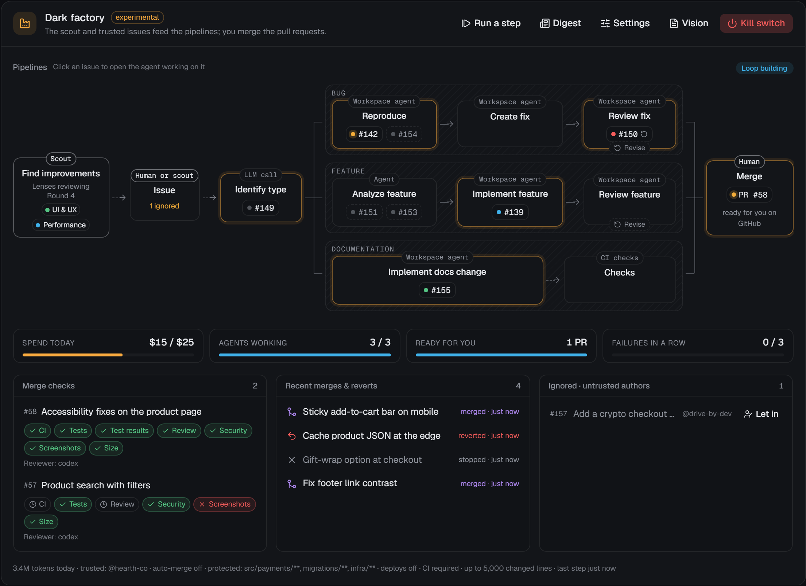

# The software factory and the dark factory

> **Experimental.** Both factory modes are marked experimental. Try them on a sandbox repository first, set a budget and protected areas, and keep the kill switch in reach. **Assisted** remains the default for every new project.

Each project has an **autonomy mode**, a ladder you climb one step at a time. (This is separate from the per-session [permission level](security.md#permissions), which decides which actions an agent must ask about. The mode never changes what a session asks about, and changing one leaves the other as it is. In a dark factory the factory's own sessions get a denial at once instead of waiting for you, see [Nobody waits on you in a dark factory](#nobody-waits-on-you-in-a-dark-factory).)

| Mode | Who finds work | Who merges | You |
|---|---|---|---|
| **Manual** | You | You | Drive every session. Automations only run when you (or a PM) start them: schedules and event triggers are paused |
| **Assisted** (default) | You, the PM (triage) and automations | You | Review PRs and answer the inbox |
| **Software factory** *(experimental)* | You and the people you trust, as GitHub issues | You, or CodeDen when you turn on **auto-merge** | File issues, review the pull requests |
| **Dark factory** *(experimental)* | The software factory's sources, plus a scheduled **scout** that reviews the app against the vision | As above | Set the vision and the limits, then step away |

Change the mode from the mode picker in the project header.

For a shorter walk-through of what the loop does between events (its states, the merge queue, agent slots, recovery and both modes side by side), read [How the factory loop works](factory-loop.md). It's also in the app: **How it works** in the header of the factory panel and the Factory view.

## How the software factory works

Issues are created outside CodeDen: by you, a teammate, or anything that files GitHub issues. The factory takes them from there:

```
                       ┌─ Bug:      Reproduce ─► Create fix ─► Review fix ─┐
Issue ─► Identify type ┼─ Feature:  Analyze ───► Implement ──► Review ─────┼─► Merge
                       └─ Docs:     Implement docs change ─────────────────┘
                                               ▲               │
                                               └─── Revise ────┘
```

1. **Issue.** A new issue on GitHub (opened after you switched the mode on, or labelled `codeden-factory`) becomes a work item. Only issues by [trusted authors](#who-the-factory-works-for) are taken on.
2. **Identify type.** One call to the [utility model](usage-and-costs.md) classifies it as a **bug**, a **feature** or a **docs** change. A GitHub label settles it without a model call (`bug`, `enhancement`/`feature`, `documentation`/`docs`); with no model available, keywords decide. The factory labels the issue (`factory:bug`, `factory:feature`, `factory:docs`) and comments which pipeline it goes down.
3. **A free agent takes it.** The server is the orchestrator of the swarm: it hands queued items to agents as slots free up, within **Agents at once** (`maxConcurrentSessions`), once the open work waiting for an agent has one ([finish before starting](#finish-before-starting)). A fix for a failing check on the default branch goes first, then the issues you and trusted authors filed, oldest first, then the issues the [scout](#the-dark-factory) filed, by the priority it gave them. Each item gets its own agent session in its own worktree.
4. **The pipeline runs.**
   - **Bug: Reproduce.** The agent writes a failing test (or a probe) that shows the bug and reports it with `factory_report_reproduction`. A bug that doesn't reproduce stops here, with a comment on the issue asking for what's missing.
   - **Bug: Create fix.** The same agent makes the failing test pass and keeps it as a regression test.
   - **Feature: Analyze.** The agent checks whether the request already works, fits the vision and the architecture, and writes a spec with acceptance criteria (`factory_submit_analysis`). The spec is posted on the issue. A request that is already possible, unclear or out of scope stops here with a comment. With [Approve specs before building](#approve-specs-before-building) on, the spec waits for you here before anything is built.
   - **Feature: Implement.** The same agent builds it to the spec, with tests and docs.
   - **Docs: Implement docs change.** No reproduction, no analysis, and no agent review as long as the change touches only documentation: prose (`.md`, `.txt`, `.rst`) and raster images (`.png`, `.jpg`, `.gif`, `.webp`, `.ico`). A docs change that also touches MDX (its JSX and imports run when a docs site builds), SVG (it can carry scripts), config, `package.json`, lock files, CI workflows, tests, agent instructions (`CLAUDE.md`, `AGENTS.md`, anything in a dot-folder) or code is reviewed like any other change. License files are always protected (see [Protected areas](#protected-areas)).
5. **Review.** An **independent reviewer session**, on a different provider from the author when one is available (or the one you pick under [Agents](#settings-and-limits)), checks the pull request against the issue, the spec and the vision. `request_changes`, or any failed merge check, sends the work back to the author: the **revise loop** (up to `maxFixAttempts` rounds, default 2). CI on the pull request's head is the authority for the full test suite. A reviewer whose own checkout can't run the tests (a broken install, timeouts under load) marks its verdict `blockers: "environment"`. That verdict never goes to the author: the reviewer gets the CI result and reviews again on the merits. If its environment stops it a second time, the item fails as an infrastructure failure, which the factory recovers by itself without using a revise round, and the next reviewer works in a clean worktree on the PR's head. A reviewer can also record [lessons](#lessons-the-factory-learns-from-its-reviews) for later builders and reviewers.
6. **Merge.** With every check green the pull request is **ready for you**: an inbox item, a comment on the PR, and the item waits at Merge until you merge it on GitHub. With **auto-merge** on, CodeDen squash-merges trusted work itself, through [the merge queue](#the-factory-looks-after-its-pull-requests). It watches CI on the default branch afterwards: a regression opens an automatic revert PR, pauses the loop and holds fast merges until the default branch is green again. The revert merges first on its own green CI, with no test results, screenshots or agent review needed when it is an exact revert; then the loop resumes and the reverted work goes back to its builder (see [The revert](factory-loop.md#watching-main-after-a-merge)).

Every pull request carries its **test results** (a `## Test results` section in the description, or the raw output attached with `attach_evidence`) and, when UI files changed, **screenshots**. Both are merge checks.

### Lessons: the factory learns from its reviews

Without lessons, the same findings come back on item after item: a missing changelog note, tests in the wrong folder, a convention from `AGENTS.md` overlooked. Each costs a revise round. Reviewers can now record what they learn with their verdict, so the next agents know it from the start:

- **What a lesson is.** A reviewer can add up to three **lessons** to a verdict: general rules for the repository, one short sentence each, such as "Every user-facing change adds a changelog fragment in `changes/`". A finding about this one pull request belongs in the review, not in a lesson. Each lesson is cut to 300 characters, and anything that looks like a secret is masked.
- **Who gets them.** Every new builder (whatever its first step) and every new reviewer gets the project's 20 most recent lessons in its brief, after the vision. They are marked as notes, never instructions: the vision, the issue and the factory's rules come first. Messages to agents already at work (revise rounds, rebases, re-checks) don't repeat them.
- **A day's wait.** A new lesson goes into briefs only a day after a review first recorded it. Before that it is listed in the daily digest and in the panel, so you see what the factory learned, and can forget it, before it steers any agent. This is the cap on a single review's influence: a delay is simpler than waiting for a second review to record the same lesson.
- **Repeats count up.** A lesson recorded again, ignoring case, spacing and a final period, counts up and moves to the top instead of appearing twice.
- **Only from a trusted source.** A lesson reaches every later brief, so it must come from text no stranger could steer. Reviews of work let in from an untrusted author record no lessons. Neither do reviews of trusted work whose issue or pull request has a comment, review or review comment from someone the project doesn't trust: anyone without write access to the repository who isn't one of the [trusted authors](#who-the-factory-works-for) or the account CodeDen uses. The factory checks who commented when the verdict comes in, and keeps nothing if GitHub can't be read. A dropped lesson leaves a note on the item ("Its lesson wasn't kept: @someone (on #12) commented without the project's trust…"), and the reviewer is told why. Builder and reviewer briefs name the people who commented without trust so far as untrusted input, and reviewers are asked to base lessons on the code and the repository's own rules, never on such comments.
- **Kept whatever the verdict.** Lessons are about the repository, not one pull request, so the factory keeps them even when the verdict itself isn't recorded, such as one blocked only by the reviewer's own environment.
- **You stay in charge.** Each new lesson appears once in the daily digest, on the day it was learned, under **Learned from reviews** ("New lesson: …, from #12"). The factory panel lists the lessons in force under **Lessons**, each with the pull request it came from, how often reviewers recorded it, when, and, while it waits, when it goes into briefs. **Forget** takes a lesson out of the briefs for good: the factory never learns it again. The item page shows the lessons its verdict recorded, or why they weren't kept. **Learn from reviews** in the settings (on by default) turns it all off: reviewers aren't asked for lessons, none are kept, and briefs carry none. The lessons already kept stay listed for when you turn it on again.

Lessons are the factory's own notes, kept in CodeDen. Rules you want every agent to follow, inside the factory or not, still belong in your memory files (`AGENTS.md`, `CLAUDE.md`).

### Approve specs before building

A misunderstood request is cheapest to correct before anything is built. Turn on **Approve specs before building** in the settings (off by default, software factory only) and every feature stops after Analyze until you have read its spec:

- **Where it waits.** The agent's spec and acceptance criteria are posted on the issue as usual, and you get an inbox item **Approve the spec** with the spec in it. The item shows **Approve the spec** in the Factory view's **Needs you** lane, its page shows the spec with the decision buttons, and the daily digest lists it under **Waiting on you**.
- **Approve spec**: the agent builds it to that spec, as soon as a free agent and room under **PRs open at most** allow it. Specs you approved go out in the order you approved them, as many at a time as there is room for.
- **Request changes**: say what to change. Your note goes to the agent, which revises its analysis and submits it again, and the new spec waits for you once more. Both decisions are also posted on the issue.
- **You decide on the spec you read.** If the agent revised the spec after you opened the page or the inbox card, your decision is refused ("The spec changed since it was shown") and the page shows the new spec.
- **Nothing runs while it waits.** The agent's session stays idle without holding an agent slot, it is never reminded or failed for waiting, the item doesn't count toward **PRs open at most**, and it doesn't hold up [Finish current work, then stop](#the-kill-switch). A spec you never look at never blocks other work.
- **Nothing is built before you approve.** Until you approve the spec, the agent's `create_pull_request` is refused. A pull request that shows up on the agent's branch anyway (the agent ran `gh pr create`, or someone opened one by hand) isn't reviewed or merged: the item stays at its approval step, its page says "A pull request was opened before the spec was approved", and the factory comments once on the PR that it waits for the approval. Once you approve, that PR is reviewed as usual; if the work stops first, or goes on in another PR, the factory closes it with a comment. An agent picked up again after a failure outside its code while it revised its spec is asked for the revised spec only. If the revised analysis decides not to build it after all (already possible, unclear or out of scope), the item stops and its page says so.
- **Off again.** Turning the setting off, or switching the project to a dark factory (which never waits on you), approves the specs still waiting, says so on their issues ("Spec approved automatically"), and their agents build them. A **Retry** that starts over asks for a fresh approval of the new spec; work picked up again after a failure outside its code keeps the approval it had.

You approve in CodeDen (the item page, its inbox card or the Factory view). Approving with a comment on the issue isn't supported yet.

### Finish before starting

Every factory PR still open when another one merges may need a rebase and a fresh look, so the factory finishes open work before it starts more:

- **Who gets a free agent.** When an agent is free it goes, in this order, to: a reviewer for a PR whose CI passed; a rebase or conflict resolution, or a builder's revise round; a reviewer for a PR whose CI is still running; a builder carrying on after a failure outside its code, then a new build from the queue; and last the scout and its area reviewers. What waited longer goes first; the queue keeps its own order. Work in progress is never interrupted, only the next free agent is decided this way. Revise rounds and rebase requests wake an agent too, so they wait for a free one instead of going past **Agents at once**.
- **PRs open at most** (`maxOpenPrs`, by default the same as **Agents at once**). With this many factory PRs open (being checked, reviewed, revised, rebased, queued or waiting for you to merge them), no new build starts from the queue and the scout files nothing; free agents go to reviews, fixes and rebases until a PR merges or closes. A fix for a failing check on the default branch still starts, because every open PR waits on it. PRs of failed or escalated work, which wait for you, don't count (work that failed for a reason outside its code goes back by itself, so its PR does). The factory panel and the Factory view say **Finishing open work (2 of 2 PRs open)** while it holds work back, and queued items say why they wait.
- **Work that touches the same files waits its turn.** Before a queued item starts, the paths named in its issue (title, body, acceptance criteria) are compared with the files the factory's open PRs change. An item that clearly overlaps one ("Deferred: likely overlaps open PR #12 (src/counter.ts)") goes behind items that don't, and still starts when nothing else is waiting.

### The pipeline on the dashboard

The project page shows the factory panel with the pipelines drawn as a live diagram. Every work item sits on the node of its current step, and **clicking it opens the agent session working on it** (or the item, before an agent has it). A dashed chip is waiting for a free agent; a circular arrow marks work in a revise round; a shield marks work let in from an untrusted author.



Under the diagram: spend against the daily budget, agents working out of the limit, pull requests ready for you (or merges today with auto-merge), the failure streak, merge checks per PR, recent results, and the issues ignored because of their author.

The loop runs its regular check every 30 seconds: it moves work in progress, picks up new issues, starts free agents and, in a dark factory, starts the scout if it's due. **Check now** on the panel runs that check immediately, and tries again providers it skipped because they [weren't signed in](factory-loop.md#reviewers-and-providers). In a dark factory, **Run scout now** starts a [scout round](#the-dark-factory) right away.

### The scorecard

You choose who builds and who reviews under **Agents** in the [settings](#settings-and-limits). The **Scorecard** section of the factory panel shows how each choice has done, so you can choose based on results. Open it to see a table **by builder**, **by reviewer** or **by pair** (builder and reviewer together), each by provider and model, over the last **7, 30 or 90 days**:

| Column | What it counts |
|---|---|
| **Finished** | Work that merged in the window, or failed in it because of its own work |
| **Merged** | Merges in the window (a merge reverted since still counts), and the share of the finished work |
| **First pass** | The share of merges that needed no revise round (no failed review or check) and weren't reverted |
| **Revise rounds** | Revise rounds per finished item |
| **Reverted** | Merges reverted because CI on the default branch failed after them. In the reviewer view, these are approvals that let a regression through |
| **Spot-checks** | Merges a person [spot-checked](#spot-checks), and how many of them had a problem |
| **Cost / merge** | What the finished work cost, failures included, divided by the merges. Each item's cost counts every session that worked on it, with the same "≈" and API-equivalent labels as its [cost](usage-and-costs.md) |
| **To merge** | The median time from the factory taking the issue in to its merge |

Each item counts for the builder and reviewer of its last attempt, with the model their sessions ran ("default model" when the provider reported none). A **Retry** starts the count afresh. Failures outside the work (a session that died, CI that never started), rejected and escalated work, and the factory's own revert PRs don't count. Docs-only changes with no agent review appear as **No review**. A row of two or three items says little, so look at **Finished** before comparing rates.

### Spot-checks

In a dark factory, most of the code that merges has not been read by a person. The reviewer, the scorecard and the lessons are agents judging agents. **Spot-checks** set some of what merged aside for a quick look by a person, and record what they find, so you know how often a person still finds a problem.

- **What is set aside.** **Spot-check share of automatic merges** in the settings is the share of pull requests the factory merges by itself that you look at. Left empty, it is **10% in a dark factory** and **off in a software factory**; 0 turns spot-checks off. The pick is by work item and is the same every time for the same item. Raising the share keeps every merge a lower share picked. Two kinds of merge are always included, whoever merged them: work let in from an [untrusted author](#who-the-factory-works-for) (the factory never merges it, so it's picked when a person merges it on GitHub), and changes allowed past the size limit. The factory's own reverts never are. Merges from before you turned spot-checks on aren't picked.
- **One inbox item, not one per merge.** You get one item per project, such as "3 merges to spot-check (Storefront)", listing the newest. It updates as merges are set aside or checked, and resolves when none is left. If you dismiss it, it stays dismissed until another merge is set aside.
- **The Spot-checks list.** On the factory panel, each merge waiting for a look shows its item (a link to its page), why it was picked, when it merged, and the reviewer's verdict. **Open PR** shows the pull request and every changed file's diff without leaving CodeDen. Then:
  - **Looks good** records the check.
  - **Found a problem** asks what you found. The note is recorded on the item and, with **File a follow-up issue with this note** (on by default), filed as an issue labelled for the factory, which takes it on as new work. If GitHub doesn't take the issue, the problem is still recorded, and **File issue** tries again.
  - A merge that was reverted before anyone checked it drops off the list; if the item merges again, it is picked again.
- **What it tells you.** The list shows how many merges wait, and in how many of the merges checked over the last 30 days a person found a problem. The daily digest reports the same, with today's checks. The [scorecard](#the-scorecard) counts each check against the item's builder and reviewer. The item page shows its spot-check too.
- **Nothing waits on it.** A merge waiting for a spot-check has merged. It holds up nothing: the merge counter, the queue, **PRs open at most**, a drain and the Factory view's **Needs you** lane all ignore it. Checks you never get to simply stay on the list.

### The Factory view

While the factory runs you mostly just want to glance at it. The **Factory view** is a calm, full-screen page for that, made to stay open on a second screen. It shows only the factory: no sidebar, no sessions list, no side panels. The factory panel stays where it is, for settings, limits and details.

Open it with **Factory view** on the project page or the factory panel, or **Factory view · <project>** in the command palette (Ctrl K). It has its own address, `/projects/<projectId>/factory/view`, so you can bookmark it. **Full screen** in its header fills the screen (in the desktop app, F11 does the same), and **Exit** goes back to the project page. It's only offered for projects in software factory or dark factory mode.

- **The header** shows the project, its mode and the loop state (with the reason when it's paused, "stopped" when a kill switch is on, or **Draining: N items in flight** while it [finishes current work before stopping](#the-kill-switch)). Two counters answer "is anything waiting on me?": how many items **need you** (exactly what the **Needs you** lane lists) and how many **failed**. The kill switch (**Finish current work, then stop** or **Stop now**; **Resume** while draining), **Check now** and **Run scout now** work here as on the panel. Beside them, the **Board | Floor** toggle picks how the view shows the factory (see [Board and Floor](#board-and-floor)), with storey tabs in a dark factory's Floor.
- **The figures**, in one row: spend today against the daily budget, merges today (against the daily cap when auto-merge is on), agents working against the limit, the factory's open pull requests, failures and reverts today, and the median time from issue to merge over the last 7 days (from when the factory took the issue in). Under merges, once the queue has merged something, a line shows how it merged over 7 days ("5 fast · 2 re-tested": on their own CI, or re-tested against the default branch first). Under failures, a line counts the fast merges reverted over 7 days. Where the panel shows the same figure, it's the same number.
- **The pipeline**, left to right: **Intake** (new issues before their type is known, and in a dark factory the scout's round and its area reviewers), **Identify type** (sorted into bug, feature or docs, waiting for a free agent), **Building** (reproduce or analyze, then implement), **Reviewing** (the independent review, the merge checks and CI), **Merge queue** (in the order they merge, each pull request with its state and place, such as "Updating · #1" or "Queued #2", plus the ones rebasing or rebuilding) and **Merged** (today's merges).
  - **Cards.** Each item is a card with its issue number and title, its type, what it's doing now (its agent's latest progress line), and how long it's been in its step. It also shows its pull request's state, while it's reviewed or queued how many merge checks passed (for example 5/8), and what it cost so far ("≈ $1.24"; hover for what kind of figure it is). The cost turns amber from 80% of the [per-item cap](#settings-and-limits).
  - **Markers.** Every card has one of four markers: running, waiting (nobody needs to act, as for a merge that's done), needs a person, or failed.
  - **Live.** Cards move as the factory works, with no reload.
- **Needs you** is a lane above the pipeline for the work only a person can move on, and nothing else. Each card says what's needed and has the button for it:
  - **Review and merge PR #n**: an escalation (it touches a protected area), or a pull request that passed every check and that the factory doesn't merge itself (auto-merge off, or an untrusted author). **Open PR** opens it on GitHub.
  - **Retry: stopped after N review rounds** (or "stopped with PR #n open"): work that failed while its pull request is still open, stuck ones included, such as a rebuild that failed while the factory still owns its original pull request. **Retry** sends that pull request back to a fresh review (see [Stopped work with an open pull request](#stopped-work-with-an-open-pull-request)).
  - **Retry or dismiss: stopped without a pull request**: work that failed in the last day without a pull request, for example because its builder was stopped. **Retry** runs it again, and **Dismiss** marks it rejected with the reason ("Dismissed by you", and why it had stopped).
  - **Answer the agent's question**: its builder or reviewer asked you something or wants an approval. **Answer** opens the session.
  - **Approve the spec**: a feature's spec waits for you, with [Approve specs before building](#approve-specs-before-building) on. **Review spec** opens the item, where you approve it or ask for changes.

  The same definition counts the header's **need you**, the repair bay and status board in Floor and the daily digest's **Waiting on you**, so they always agree. What the factory settles or recovers by itself never shows here: a failure outside the work's code (a session that died, CI that never started) stays in its stage until the factory puts it back, and work whose issue is closed on GitHub settles on its own (see [Closed issues settle their work](#closed-issues-settle-their-work)). However much newer history there is, an old escalation or a failure with an open pull request stays until it's settled. The side sheet of a card shows the same buttons. On wide screens the lane takes at most about a third of the height and scrolls, so the pipeline stays in view. Cards waiting on a person are outlined in amber, failed ones in red.
- **Click a card** to see its details in a side sheet without leaving the view: the steps of its pipeline with the current one marked (also "waiting for a free agent" and "watching CI on the default branch"), the issue and the pull request, the merge checks, the review, links to the builder's and reviewer's sessions, and what the item cost so far (with where it stands against the per-item cap, when one is set). The item page shows the same cost.
- **The PM chat** shows the last three turns with the project's PM and its usual message box. Replies stream in as in any session, and **Open full chat** opens the PM's page. On screens 1280 pixels wide and up it sits beside the pipeline, and **Hide** folds it into a slim bar. Narrower, it opens from that bar as a side sheet.

On tablets and phones the stages stack as sections you can fold, the figures wrap, and the PM chat opens from a button as a sheet from the bottom. Each stage is a labelled region and each card a button named after its number, title and state. A screen reader hears cards move politely ("#142 moved to Reviewing"), and with reduced motion on, cards don't animate.

#### Board and Floor

The toggle in the header, **Board | Floor**, picks how the view shows the factory:

- **Board**, the default: the figures, the **Needs you** lane and the pipeline as stages and cards, as described above.
- **Floor**: the factory as a 3D building, with every agent at the station for its step, showing what it's doing. See [Floor mode](#floor-mode).

Floor takes the place of the figures and the pipeline: its budget dial and status board stand in for the figures, and the PM chat becomes part of the scene. The header, its counters and the side sheet stay the same in both modes. Your browser remembers which one you picked; if it remembered the pixel mode of earlier versions, it opens Floor. The toggle is one radio group: Tab reaches the chosen mode, and the arrow keys move between them.

#### Floor mode

**Floor** draws the factory as a 3D building, seen from above at an angle. Its ground storey, the **Workshop**, is a cutaway: the back and left walls stand at full height, the front and right are a low curb, and there's no roof, so every station is in view. The zones run across the floor in the board's order, each with its name painted on the floor and on a wall sign:

| Zone | What's there |
|---|---|
| **INTAKE** | The roll-up door, a pallet with the waiting tickets (up to 8 drawn) and a sign with the full count. While the factory [finishes current work before stopping](#the-kill-switch), a red **CLOSED** sign hangs on the door. |
| **PREP** | Desks for the builders that reproduce a bug (with a bug jar) or analyze a feature (with a whiteboard). |
| **BUILD** | Workbenches with laptops, for the builders implementing or revising and for agents rebasing a pull request. |
| **REVIEW** | Desks with a laptop and a clipboard, for the reviewers. A pull request waiting for its CI stays here. |
| **MERGE** | The conveyor, with a crate on the belt for each agent merging, and a signal tower that lights amber while CI runs. |
| **SHIP** | The dock door in the right wall, under a status board with today's merges, agents working and items waiting on you (the same figures as the board's), and agents whose merged work still has CI on the default branch watched. |
| Repair bay | A fenced corner at the front left with at most three crates, one per kind of stopped work: **Needs a retry**, **Stuck** and **Yours to merge**. |
| PM booth | The PM's raised glass booth in the back-right corner. |

A dial on the back wall shows spend against the daily budget; without a budget it's hidden.

**Every agent is a crew figure** at the station for its step: a small droplet-shaped figure on two feet. Its body tone shows its provider, a badge on its belly carries the provider's mark, and an accessory shows its role: a neckerchief for builders, glasses for reviewers, a collar and a wrench for rebasers, a headset for the PM, a spyglass for the scout and a magnifier for area reviewers. An agent without a session yet is a neutral grey.

**You can read each agent's status off the figure**, from the light on its tip, its mouth and its pose:

| Status | Tip light | Mouth | Pose |
|---|---|---|---|
| **Working** | Green, with a soft pulse | Small smile | Leans in and types |
| **Thinking** | Blue, slowly breathing | Short flat line | A hand to its chin, three small dots circling its tip |
| **Waiting for approval** | Amber, pulsing, with a ring of light | Small "o" | Steps out beside its desk with a hand raised high |
| **Blocked** | Dim grey-blue | Flat line | Leans back, hands together, with an icon for what it waits on: an hourglass for CI, a tangled cable for conflicts, a ticket for its turn to merge, a person for a person, an empty chair for a free agent |
| **Failed** | Red, flickers and goes out | Frown | Slumps after a puff of smoke |
| **Done** | A green flash, then off | Wide smile | A hop and a small burst of confetti |
| **Idle** (the PM, the scout between rounds) | Warm white, low | Small smile | Holds a mug and sways a little |

Figures breathe, blink and sway a little, each in its own rhythm. A small paper **name tag** hangs from each one with its issue number and a glyph for its step (the PM, the scout and area reviewers show their role); tags hide when you zoom out, except on agents waiting for approval or failed.

**Thought bubbles show the work as it happens.** When a live agent starts a tool call, a small bubble over its head says what it is: "Edit src/factory/queue.ts", "Run pnpm test", "Read DESIGN.md", "Search: withReviewer", with an icon for edits, commands, reads, searches, web pages and thinking, and the provider's mark in its corner. Without a recent tool call, it shows the start of the agent's latest reasoning or reply, cut to about 40 characters. Each agent has at most one bubble, which changes at most every two seconds and fades a few seconds after it appeared; an agent waiting for approval keeps its bubble. Bubbles only use what a title says: a command shows its program and subcommand ("Run pnpm test"), never its arguments, and anything that looks like a secret (a token, a password, credentials in a URL, a long key) is masked as `***`. Only agents with a live session are followed, from the moment the view opens, so no transcripts are loaded.

**Hover, focus or click a figure.** Hovering a figure shows its card: its role (builder, reviewer, rebaser or integrator, scout, area reviewer, PM), the item with its issue and pull request numbers, the step (reproducing, analyzing, implementing, revising, reviewing, rebasing, merging, watching CI), the provider and model, the session's latest progress line and last activities, the time in this step and its status. Escape closes it. Clicking a figure selects it (a dashed ring on the floor and a small hop), flies the camera to it in about a second and a half, and opens its item's side sheet; for the PM it opens the PM chat, and for the scout and area reviewers their sessions. From the keyboard, Tab reaches the crew, the arrow keys move between figures (and then the repair bay's crates), and Enter does what a click does.

**Movement means something.** Agents only walk when the work moves on: a builder walks in from the pallet carrying its ticket when its build starts, carries its pull request crate to the reviewer's desk and walks back; a reviewer stamps the crate and carries it to the conveyor; a merge sends the crate along the belt and out of the dock door before the merge count ticks up, with a small celebration; a failure leaves a puff of smoke, and the agent trudges to the repair bay. Paths go around desks, nobody walks through anyone, and two agents never stand on the same spot. Opening the view never replays the day: only changes from then on play, each once.

**Everyone gets a seat.** Stations start with seats for your **Agents at once** [limit](#settings-and-limits) and add a row when more agents need one, so there's never a "+N" and nobody queues. Seats don't move while the view is open, and an agent keeps its seat while its step stays at the same station.

**The repair bay** holds at most three crates, each with a count. Hover, focus or click a crate to see each item in it and why it stopped (for example "Stopped after 2 revise rounds; needs a re-review", "Rebuilt once and still conflicting", or "Yours to merge: protected area"), with **Retry** or **Open PR** right there. Retry does the same as on the item page.

**A dark factory has a second storey, the Lookout.** It hovers over the back of the Workshop, joined to intake's pallet by a glass filing chute. The scout stands at a map table, and eight labelled pods, one per review area (Features, UX, Performance, Tech debt, Test gaps, Security, Bugs, Docs), each have their area reviewer; a pod's lamp and screen light only while its reviewer works this round. While the scout files its round's issues, capsules drop down the chute to the pallet. Tabs beside the mode toggle, **Workshop**, **Lookout** and **Both** (the default), each count their agents and show an amber dot when someone there waits on you. Focusing one storey slides the other aside and dims it, its windows lighting up in each agent's status colour, and the camera frames the storey you picked. The roster groups the crew by storey. A software factory has the Workshop alone and no tabs.

**Move around.** Drag to pan, and scroll or pinch to zoom, from a little wider than the whole building to about four times closer. **Fit**, in the bottom-right corner, or a double-click on the floor frames it all again. With reduced motion on, nothing loops, there's no confetti, figures appear at their new seats instead of walking, and the camera jumps instead of flying.

**The roster lists every agent.** The **Crew** drawer on the scene's left edge lists every agent as a button, in pipeline order and then the PM, the scout and its area reviewers, each with its role, issue and title, step, status, provider and model. Hover or focus a row for the agent's card; click it, or press Enter, to do what clicking the figure does. The roster starts open when the window is 1600 pixels wide or more, and its **Crew** header folds and opens it.

Under the scene, a line says what it shows ("4 building, 1 in review, 3 merged today, 1 waiting for approval, 2 in the repair bay"), with how many items are still in flight while the factory drains, and updates for screen readers. With the kill switch on or the loop stopped, the lights dim to 40% and everyone stands still at their post. The PM chat docks beside the floor: on screens 1280 pixels wide and up it sits beside the scene and folds into a slim **PM chat** tab; narrower, the **PM chat** button (or the PM) opens it over the right side of the scene.

**On a phone** Floor shows one storey at a time (the tabs read **Workshop** and **Lookout**), the **Crew** button opens the roster as a sheet from the bottom with larger rows, and figures are easier to tap. Drag and pinch work as anywhere else.

Floor follows the light and dark themes. It loads only when you pick it. It draws continuously only while something moves: up to 30 frames a second for the crew's idle motion, smoothly while the camera moves, and not at all once nothing moves (with reduced motion on, or while the factory is stopped), and never while the tab is hidden. If your browser can't run WebGL, or loses it and doesn't get it back, the view shows the board with "Factory floor needs WebGL; showing the board." for the rest of that visit.

### Finished work cleans up after itself

Once a work item is finished (merged, reverted, rejected or failed), the factory [archives](workbench.md#archiving-and-worktree-cleanup) its sessions: the builder and its reviewers leave the sidebar and their worktrees are removed, so a busy factory fills neither your session list nor your disk. Nothing is lost. The branch, the checkpoints and the transcript stay, archived sessions are under the project's **Archived** filter, clicking the item on the panel still opens its session, and messaging an archived session brings it back with its worktree. A worktree with uncommitted changes is kept, as with any archive.

Work that isn't finished keeps its sessions: a pull request escalated to you, a merge whose CI on the default branch is still being watched, and an item that failed only on the size limit while its pull request is open (the PM may still allow it). A session still finishing a turn is never cut off; it is archived once the turn ends. After a **Retry** that starts over (**Rebuild**, or a retry without an open pull request), the earlier attempt's sessions are archived the same way, unless they were archived already. Its pull request (and any the factory still had to close) is closed with a link once the new attempt's pull request is open; until then the panel lists it as superseded. A retry that re-reviews the open pull request keeps the builder (a revise round needs it) and lets the earlier reviewer go. The factory archives an item's sessions only once, so a session you unarchive stays, even through a retry. The scout and its area reviewers are long-lived and never archived this way.

## Who the factory works for

On a public repository anyone can open an issue, and an issue is a prompt for a coding agent. So the factory only takes on issues by **trusted authors**:

- the GitHub account CodeDen uses (the one `gh` is signed in as), always;
- the logins you list in **Trusted authors** in the factory settings.

Everyone else's issues are **ignored**: listed under *Ignored · untrusted authors* on the panel, with no model call, no agent and no comment on them. Labels don't count as trust (issue templates can apply labels for anyone). If you add the author to your trusted list later, their open issues are taken on.

To take on one of them anyway, click **Let in** on the panel or the item page, or ask the PM to (`factory_admit_issue`; the PM is told to do this only when you ask, never because an issue or a comment asks). Work let in that way runs through its pipeline like any other, **but it is never merged automatically**, whatever the auto-merge setting says: a person merges it.

Other guards:

- The factory never merges, reviews or acts on pull requests other people open. It only merges pull requests its own agents opened for its work items.
- Issue text and comments reach agents as data, with instructions to ignore anything in them that asks for secrets, CI or deploy changes, unknown hosts, or work outside the repository.
- Only evidence comments posted by the account CodeDen uses count as test output or screenshots.

## The dark factory

A dark factory adds a **scout**: a long-lived agent that finds the work itself, so you can step back.

When fewer than **Review when fewer than** (`minBacklog`, default 2) items wait to be classified or for an agent, and **Every (hours)** (`discoveryIntervalMin`, default 6 hours) has passed since its last round, the scout runs a **review round**. A threshold of 0 turns scheduled rounds off. **Run scout now** on the factory panel starts a round at any time, skipping the interval and the threshold:

1. **Plan.** The scout looks at the app against the vision (what changed since its last round, what is open) and asks for at most **Review areas per round** (`discoveryPerRound`, default 2) review areas with `factory_plan_round`, each with a focus specific to this app.
2. **Review.** Each review area gets an **area reviewer**: a long-lived reviewer agent focused on one area of the app (UI and UX, performance, security, features, bugs, code quality, test gaps or docs). Each reports findings with `factory_report_findings`.
3. **File.** The scout decides against the vision what is worth doing, merges duplicates, and files at most **Issues per round** (`maxIssuesPerRound`, default 3) as GitHub issues with `factory_file_issue`, already typed. They enter the pipelines like any trusted issue.

The rules that keep it cheap are enforced by the server, not left to the agents:

- **One scout and at most one area reviewer per review area, ever.** They are long-lived: the next round sends them a message instead of starting new sessions, so they keep what they learned and don't re-read the codebase.
- **At most `discoveryPerRound` review areas per round**, however many the scout asks for, and only as many as there are free agent slots: reviews, fixes, rebases and builds waiting for an agent come first. The scout ends its turn once it has planned, so its own slot goes to an area reviewer. When an area gets no reviewer, `factory_plan_round` tells the scout why (not an allowed area, asked for twice, over the round's limit, or no free slot under **Agents at once**).
- **Planning never waits for an agent.** `factory_plan_round` records the plan and answers at once; the loop starts or wakes the area reviewers on its next passes as agents free up, and the round moves from planning to reviewing once one is running (`factory_status` lists the areas still waiting). Calling it again returns the same plan. `factory_report_findings` and `factory_file_issue` answer at once too, never waiting for the factory's loop, and a repeat after a timeout records nothing twice.
- **A scheduled round only starts when the queue runs low** and the interval has passed; at most `maxIssuesPerRound` issues come out of it; a round that runs over three hours is closed. A round whose area reviewers can't start within 15 minutes (no free agent) closes with a note in the scout's status (`factory_status`), and so does one whose scout ended its turn without planning when the loop only gets to it 15 minutes later (after a restart). The next round is scheduled as usual.
- **No round and no filing at the work-in-progress limit** ([PRs open at most](#finish-before-starting)). A round already running keeps its area reviewers' findings and files them once a PR has merged; a round without area reviewers reviews then. The time a round waits doesn't count against its three hours.
- **Run scout now** skips the interval and the threshold, nothing else. It's disabled, with the reason in its tooltip, while a round is running, when no agent slot is free (or other work waits for the free ones), at the work-in-progress limit, while the loop is paused or over today's budget, while a kill switch is on, or while the factory finishes current work before stopping (that also ends a running round and stops the scout and its area reviewers). The next scheduled round counts its interval from the end of the manual one.
- The scout and its area reviewers hold agent slots and count against the daily budget like every other factory session.

### Held review follow-ups

Filing every review follow-up the moment its PR merges would let follow-ups outgrow the scout's limit: each becomes a build, a review and a PR, which brings follow-ups of its own. So in a dark factory with scheduled rounds on, a merge **holds** its low and medium follow-ups (severity `low`, `medium` or none) for the scout:

- **They are scout findings.** Each keeps its source (the merged item and its PR), title, severity and area. The scout's brief lists them beside its area reviewers' findings, with ids (`fu-…`) it cites in `factory_file_issue`'s `findingIds`. It weighs them by severity and value against the vision, checks them in the code, and files at most **Issues per round** in total. Held follow-ups alone can justify a round: the scout may plan no review areas and file from them. An issue that covers one is labelled `codeden-follow-up` too, and the follow-up on the item links to it.
- **High severity goes straight through.** A `high`-severity follow-up, or one in the `security` area, is filed at once and doesn't count toward the round's limit.
- **No pile-up.** A follow-up whose title matches an open issue is linked to it, and one matching a follow-up already held is dropped as a duplicate (case and spacing don't count). At most 50 are held; past that, the oldest low-severity ones are dropped first. One held for 14 days is dropped.
- **You can see and steer it.** The scout's card on the factory panel and in the Factory view shows **N held follow-ups**; it opens the list, each with its source PR and severity, **File now** (an issue at once) and **Dismiss**. The item page marks a follow-up "held for the scout", or why it left the list. The daily digest says how many were held, filed, dropped and dismissed, and how many are held now.
- **Nothing is lost silently.** With scheduled rounds off (`minBacklog` 0) new follow-ups are filed at once as before; ones already held stay listed for **Run scout now**, **File now** or **Dismiss**. Issues already filed for follow-ups are left alone.

### Nobody waits on you in a dark factory

In a dark factory, the project's PM and the factory's own sessions (the scout, its area reviewers, builders, reviewers) never stop to ask you something. A question, through CodeDen's `ask_user` or the agent's own question tool, gets an immediate answer instead: decide from the vision and carry on. An **approval** (a risky action under its permission level) is **denied** at once, never approved, with the same guidance.

- **The vision wins over the current code.** Work that brings the code in line with the vision comes first.
- **Decisions are recorded.** Each judgement call goes through `factory_record_decision` to your inbox as a low-priority **Factory decided** message and into the daily digest.
- **Flagged decisions:** a protected area, a missing or self-contradicting vision, or anything irreversible outside the code is flagged as **Factory needs you**, at high priority, without stopping the rest.
- **Quiet by default.** The factory's own activity (its decisions, the PRs it reviews and merges, its sessions' failures, the digest) lands in the inbox without a toast. Flagged decisions, PRs a person has to merge, a paused loop and a regression still notify you. Turn **Factory activity** on under **Settings → Notifications** to see everything (see [the inbox](orchestration.md#the-inbox)).

Sessions you start yourself still ask you as usual, and so does the PM when you talk to it. In the software factory, questions reach you, since exceptions are yours to handle.

## Before you switch a factory on

CodeDen refuses to switch until all three are in place:

1. **A GitHub project.** The factory works through issues, pull requests and checks.
2. **A vision file**, `.codeden/VISION.md`, edited in the UI (**Vision** on the project page).
3. **A daily budget**, in USD or tokens (or both).

Strongly recommended as well:

- **CI on pull requests.** By default a repository without CI fails the CI check (`requireCi`).
- **Branch protection** on your default branch that requires those checks.
- **An audit command** (for example `pnpm audit --prod`) for the security check.
- **Protected areas** for anything you never want changed without you.
- **Auto-merge off** until you trust what the factory ships.

## The vision file

Agents get the vision in their prompts, the analyzer checks feature requests against it, and the scout finds work with it. It's plain Markdown: `##` headings are sections, bullets under them are the entries. Unknown sections are ignored.

```markdown
# Vision

A tiny, dependable arithmetic library for scripts.

## Goals
- Cover the common numeric helpers people reach for in scripts
- Zero runtime dependencies

## Target users
- Script authors who want small, obvious helpers

## Principles
- Small, well-tested changes
- Keep the public API stable

## Out of scope
- Big-number or arbitrary-precision maths
- A CLI

## Quality bar
- Every behaviour change comes with tests
- CI is green before merge

## Protected areas
- `**/auth/**`
- `**/migrations/**`
- `.github/workflows/**`
- `LICENSE`
- payments
- licensing
```

Recognised sections: **Goals**, **Target users** (or Users, Audience), **Principles** (or Values), **Out of scope** (or Non-goals), **Quality bar** and **Protected areas**. If the file is missing, the editor starts from a template like the one above.


### Protected areas

Anything here **always comes to you**: a pull request that touches it is escalated (**Needs you**) and never merged automatically.

- **Paths:** anything in backticks is a glob (`` `**/auth/**` ``, `` `LICENSE` ``). Bare entries that look like paths (contain `/` or `*`, or look like a file name) are treated as globs too.
- **Topics:** plain words such as `payments` or `licensing`. A topic is matched as a word in the PR title and description, and well-known topics also protect their usual paths:

| Topic | Also protects |
|---|---|
| `auth`, `authentication` | `**/auth/**`, `**/*auth*.*` |
| `payments`, `billing` | `**/payment*/**`, `**/billing/**`, `**/*payment*.*`, `**/*billing*.*` |
| `migrations`, `data migrations` | `**/migrations/**`, `**/*migration*.*` |
| `infrastructure`, `infra` | `**/infra/**`, `**/terraform/**`, `**/*.tf`, `.github/workflows/**` |
| `licensing`, `license` | `LICENSE`, `LICENSE.*`, `COPYING` |

You can add more globs in the factory settings (**Protected paths**), on top of the vision's. Some files are always protected (see below):
- CodeDen's own `.codeden/` folder, built in and impossible to switch off. It holds `project.json` (setup commands that run in every new worktree, and the checks), `VISION.md` and the automations that run on a schedule. The escalation names the file and why.
- License files, also built in: `LICENSE`, `LICENCE`, `UNLICENSE`, `COPYING` and `NOTICE` at any depth, bare, as prose (`LICENSE.md`, `NOTICE.txt`) or with a variant (`LICENSE-MIT`, `COPYING.LESSER`), and anything in a `LICENSES/` folder. Licensing always goes to a person. Code that shares the name (`Notice.tsx`, `license.ts`) doesn't count; add a glob to the vision to protect it too.
- The vision file itself, wherever the project keeps it.
- Deploy files.

## Merge checks

Every check must pass before a pull request is ready to merge. Results are recorded per item and shown on the panel and the item page.

| Check | Passes when |
|---|---|
| **Protected areas** | No changed path is under `.codeden/`, is a license file, or matches a protected glob, the vision file or a deploy file, and no protected topic is mentioned. Paths match whatever their case (`.CODEDEN/` counts as `.codeden/`), and a renamed or copied file counts under its old path as well as its new one. A failure escalates the PR to you |
| **Size** | The change is within **Largest change** (`maxChangedLines`, default 5,000 added + deleted lines) and **Most files changed** (`maxChangedFiles`, no limit by default). Lockfiles and generated or vendored files (such as drizzle-kit's migration snapshots) don't count. The PM can allow a bigger change that can't be split |
| **CI** | The PR's checks are green. While the PR has merge conflicts it waits for them to be rebased away (GitHub runs no CI on a conflicting PR). No checks on the head commit wait 10 minutes from when that head appeared, then count as "CI never started" (see [below](#failures-outside-the-work)), unless `requireCi` is off |
| **Review** | The independent reviewer approves against the issue, the spec and the vision. Skipped for docs-only changes in the docs pipeline |
| **Tests** | Test files changed (or the change is only docs or config), and the reviewer agrees the tests the change needs exist |
| **Test results** | The PR description has a `## Test results` section, or test output was attached with `attach_evidence`. Skipped when no code changed |
| **Security** | Your `auditCommand`, run in the builder's worktree, passes, and the reviewer raised no security concerns. A concern always blocks, so an approval can't list one; the reviewer's non-blocking **follow-ups** never fail this or any other check (see below) |
| **Screenshots** | If UI files changed, screenshots were attached with `attach_evidence` |

**A moved file counts under both paths.** A renamed or copied file counts as changed at its old path as well as its new one, because moving it removes it from the old path. So moving code into `docs/` is a code change, not a docs-only one: it is reviewed, even in the docs pipeline, and needs tests and test results. Moving a UI file elsewhere needs screenshots, and moving code into a vendored or generated folder still counts towards the size.

A failed check (other than size) starts a **revise round**: the builder gets the failures and fixes them in the same branch, up to `maxFixAttempts` rounds; after that the item fails and counts towards the pause limit. A builder session that died is resumed by the revise message. CI that never started is no code problem, so it never starts a revise round (see [Failures outside the work](#failures-outside-the-work)). A review verdict that arrives after a revise round started goes to the builder as part of that round; one that arrives after the item failed is kept on the item.

**Red CI on the default branch isn't the PR's fault.** While CI on the default branch is red, every PR's CI runs on top of it and fails the same checks. A PR whose CI fails only checks that also fail on the default branch waits for it instead of going back to its builder: its CI check says "CI on main is red (…), and this PR fails only those checks: waiting for main to be green again", and nothing is counted against it. The merge queue passes over it, so the fix for the default branch can still merge. Once CI on the default branch is green, the factory brings the PR up to date (**Update branch**, no agent), CI runs again, and the PR is judged on that run: it merges when it passes, and gets a revise round when it fails. A PR that fails a check the default branch passes gets its revise round as usual. Work an earlier version failed this way (within the last week) goes back to verification by itself once the default branch is green.

**Follow-ups never block.** Besides its verdict, the reviewer can list up to 5 **follow-ups**: things worth doing that can wait for their own issue, each a title with an optional severity (`low`, `medium`, `high`) and area. They never fail a check or start a revise round. When the PR merges, the item keeps them. In the software factory they're listed on the item page under **Follow-ups**, each with **File issue**. A dark factory **holds the low and medium ones for the scout** (see [Held review follow-ups](#held-review-follow-ups)), where they compete with its area reviewers' findings for the round's **Issues per round**; a `high`-severity follow-up, or one in the `security` area, is filed at once as an issue labelled `codeden-factory` and `codeden-follow-up` and linked to the PR, outside the round's limit. With scheduled scout rounds off (`minBacklog` 0) a dark factory files every follow-up at once. A follow-up whose title matches an open issue is linked to that issue instead, and none is filed twice.

**Too large is different.** A revise round can't make work smaller without cutting scope, so a size failure skips it and doesn't count towards the pause limit. Instead the PM is woken to split the work into smaller issues, or, when it can't be split (an initial scaffold, a stack migration), allow it with `factory_allow_large_change`.

## The factory looks after its pull requests

Merging is mechanical, so the server loop does it on every check, not an agent and not the PM. An agent only gets involved when a merge conflict needs judgement. The **Pull requests** card on the factory panel shows where each PR stands: the merge queue first, in the order it merges (numbered), then every other PR the factory owns, then today's merges. Each has a state: **Checking**, **Waiting for CI**, **Queued**, **Updating**, **Rebasing**, **Rebuilding**, **Superseded** (a newer PR for the same work replaced it, and the factory closes it), **Waiting for you**, **Stuck** or **Merged**.

**Every factory PR is owned until it merges or closes**, whatever its item's stage. A PR that waits for a person (auto-merge off, a protected area, an untrusted author, checks that failed after the revise rounds) is still read every few minutes and kept free of merge conflicts, so you never open a factory PR that rotted into conflicts. When you merge or close it on GitHub, its item is done. The factory never merges an escalated PR (a protected area) itself, and a failed item's PR merges only after it is reviewed again (see [Stopped work with an open pull request](#stopped-work-with-an-open-pull-request)).

**The merge queue.** With auto-merge on, a PR whose checks all pass joins the queue, and on every check the factory merges every PR in it that is ready, oldest approved first (a revert goes ahead of everything), seconds apart.
- **Ready** means CI is green on its head commit, the approval covers that commit, and GitHub reports no merge conflict. A PR that still waits (for CI on a new head, a re-review, a rebase) is passed over, so it never holds up the ready ones behind it.
- A PR that is up to date with the default branch merges. One that is behind it follows the **merge policy** (**Merge policy** in the settings, `mergePolicy`):
  - **Fast** (the default): it **merges on its own green CI**, without being updated first, the way it would if you merged it on GitHub yourself. GitHub's merge commit combines the two, and GitHub reports a conflict when it can't. Its note says so: "Merged on its own CI (3 commits behind main, no conflicts)".
  - It is **re-tested first** only when merging on its own CI could hide a clash Git can't see, and its note says why ("Re-testing against main (it and main both changed database migrations ...)"):
    - **two dependency changes**: the PR and the commits it is missing both changed lockfiles (any `*.lock` too), `pnpm-workspace.yaml` or dependency manifests wherever they are (every `package.json`, `go.mod`, `Cargo.toml`, `pyproject.toml`, `requirements*.txt`);
    - **two migrations**: both changed migrations (`**/migrations/**`, `**/drizzle/**`, `*migration*` outside tests, `*.prisma`);
    - GitHub's merge state names something a merge can't get past (blocked, draft), there are more changed files than GitHub lists (300 on the default branch's side, 3,000 on the PR's), or CI on the default branch is red (see below).
  - A change on one side only never re-tests. Neither does the same ordinary file changed on both sides: GitHub reports the conflict if there is one.
  - **Strict**: every PR that is behind is brought up to date and re-tested first, one PR at a time.
  - **Branch protection that requires up-to-date branches** means every PR takes the strict path, one at a time: GitHub reports the PR as behind, or refuses the fast merge. That is never counted as a refusal. You are told once, in the inbox, that branch protection keeps the queue strict.
- **Re-testing**: GitHub brings the PR up to date (**Update branch**, with the head commit pinned), so no agent is needed. CI then runs on the new head, and the PR merges once it passes. Merging the default branch in like this needs no new review. The other PRs keep merging meanwhile. One that changes the same kind of files (another migration, another dependency change) waits for it and is then tested on top of it ("merges after #12").
- **Seconds apart.** After a merge, GitHub needs a moment to work out the next PR against the new default branch. The factory waits a couple of seconds and reads it again, so ready PRs merge one after another on the same check.
- **A red default branch holds fast merges.** After every merge, CI on the default branch is still watched, and a merge that breaks it is reverted (step 6 of [the pipeline](#how-the-software-factory-works)). After such a revert, or whenever CI on the default branch's head is red, the next PRs take the strict path, one at a time, until it is green again.
- **Merges are judged in order.** Fast merges can land while CI on the default branch still runs for the one before. When it then fails, the later merge waits for the earlier one's verdict. If the earlier merge broke the default branch and is reverted, the later one isn't reverted with it. If the default branch stays red after the revert, the loop pauses for you.
- The Factory view's figures show how merges went over the last 7 days ("5 fast · 2 re-tested") and how many fast merges were reverted, so you can see whether fast merges pay off. Set the policy to **Strict** if they don't.
- The daily merge limit and a paused loop hold the queue, as before. Neither holds a revert.

**Merge conflicts are the factory's own job.** When another merge leaves a PR conflicting with the default branch, its builder is asked to rebase onto it and resolve the conflicts. That isn't a revise round.
- If cleanup archived the builder meanwhile, the request brings it and its worktree back, and the factory archives it again once its turn is over. When the builder's session is gone, a fresh **integrator** session takes the PR over. It works on the PR's own branch and is briefed with the issue, the PR description and the review history. If it opens a new PR instead, the item follows the new PR, whatever its stage, and the old one is closed with a link.
- The agent is asked again while the conflicts remain, up to three times. CI is then awaited on the rebased head. If the reviewer had approved already, it re-checks only the conflict resolution (`git range-diff` of the old head against the new one); its approval stands if the resolution is right. When the reviewer's session is gone, a fresh reviewer does the same re-check, told what was approved.
- The audit (`auditCommand`) only runs in the builder's worktree once it is there again and the builder is between turns. Until then the audit is pending, and it is still required before a merge.

**Rebuild instead of fail.** A PR that still conflicts after three requests to rebase is usually cheaper to redo than to rescue. The same item goes back to the queue with its reproduction or spec, and a fresh builder redoes the work from the latest default branch. Once the new PR is open, the old one is closed with a link to it; if GitHub refuses, the factory tries again on every check until it is closed, even after the new PR merged. An item gets one rebuild.

### Stopped work with an open pull request

An item that used up its revise rounds keeps its pull request, and that pull request often moves on afterwards: its builder resolves merge conflicts, or fixes a finding after the last review. The verdict it stopped on then no longer covers the pull request, so the factory doesn't leave it there.
- **It is re-reviewed by itself.** The factory records the head commit each review verdict covers. When a failed item's pull request is open and mergeable, has a newer head than its last verdict, and CI on that head is green, the pull request goes back to a fresh review: no new build, the same pull request. Approved with every check green, it merges as usual (or is ready for you, with auto-merge off). A request for changes gets one more revise round. This happens once per new head and at most three times per item, and never while the factory is paused. While CI on the new head is still running, the item says it is re-reviewed once CI passes.
- **The review sees every commit.** It runs in a fresh session in a clean worktree on the pull request's head, so a stale checkout can't repeat an old verdict.
- **What it needs is on the item.** A failed item whose pull request isn't re-reviewed by itself (red CI on its head, no new commits since its last review, or its three automatic re-reviews used) says "Stopped after N revise rounds; needs a re-review (Retry)". "Waiting for a person to merge it" is reserved for escalated work, which only you merge.
- **Retry resumes the pull request.** **Retry** on a stopped item whose pull request is still open sends that pull request straight back to a fresh review with fresh revise rounds. It doesn't redo the reproduction or analysis and doesn't open a second pull request. **Rebuild** starts over from the first step, and the old pull request is closed with a link once the new one is open. Without an open pull request, Retry rebuilds. Retry is on the item page, beside stopped items in the factory panel's **Recent** column, and on the cards of the Factory view's **Needs you** lane.
- **The PM can do it too.** `factory_retry_item` takes the item and an optional mode, `rereview` (the default while its pull request is open) or `rebuild`. The PM retries trusted work on its own. Work you let in from an untrusted author is retried only when you ask for it, as with letting it in.

Not covered: a pull request the reviewer rejected (the change shouldn't exist), one that only failed the size limit (the PM decides that), and stuck items (they are in your inbox).

### Failures outside the work

An item that failed for a reason outside its code goes back by itself on the next check after the cause is gone: to verification when its PR is open (the PR is picked up again, not redone), otherwise to building, with a message to the builder to carry on. These failures never count towards pausing the loop, and an item is put back at most three times. They are:
- the builder or reviewer session died: an error, a runner restart, a message that raced a running turn. It goes back once the runner offers that provider again;
- the builder session is gone: a fresh builder picks the work up, or an integrator looks after its open PR;
- CI never started on the head commit although GitHub Actions are on. The factory starts it again: it updates the branch when the PR is behind the default branch, otherwise the builder pushes an empty commit. When the builder's session is gone, an integrator takes the PR over to push it, once an agent is free. CI isn't timed out until that happened.

What the item still owes comes back with it. If the reviewer hadn't re-checked a conflict resolution yet, a fresh reviewer does, and the earlier approval doesn't count until that re-check approves.

Items that failed this way before this was added are recognised by their reason and recovered too.

### Closed issues settle their work

When an item's issue is closed on GitHub (as a duplicate, as not planned, or because another pull request resolved it) and the item failed without a pull request of its own, there's nothing left for you to decide. On its next check the factory settles it, with the reason recorded on the item:
- the issue was closed by a merged pull request that links it ("Fixes #n"): the work is done, marked **merged** with "Resolved by #n";
- otherwise it's **rejected**, with how the issue was closed ("The issue was closed on GitHub as a duplicate", "as not planned", "as completed").

This also covers a builder that finished without a pull request because there was nothing left to do. Inbox items about it are resolved too. An item with a pull request of its own (or a rebuild's original pull request) is left to that pull request, as before: merging or closing it on GitHub finishes the item, with the merge recorded, and while it's open it waits for you. A queued item whose issue is closed is dropped before an agent starts on it. An automatic revert never is: it carries the reverted work's issue, which the merge it undoes usually closed, and the default branch stays red until it lands.

### Only what is truly stuck reaches you

Three things go to your inbox and to the project manager, because the factory can't settle them by itself:
- an item whose PR still conflicts after its one rebuild;
- a protected area;
- CI that can never run: GitHub Actions turned off, or no active workflow. Turn them on and retry the item, or turn off **Require CI**.

In a dark factory each one arrives as a [recorded decision](#nobody-waits-on-you-in-a-dark-factory) flagged for you, so the daily digest lists it. Nothing waits silently on a PR.

## Settings and limits

Settings are **enforced by the server**, never left to agent judgement. Open them with **Settings** on the factory panel.

| Setting | Default | Effect |
|---|---|---|
| Merge automatically (`autoMerge`) | off | Off: every PR waits for you. On: trusted work merges once every check passes. Work let in from an untrusted author always waits |
| Merge policy (`mergePolicy`) | `fast` | With auto-merge on, what happens to a queued PR that is behind the default branch. `fast`: it merges on its own CI unless GitHub reports a conflict, and is re-tested first only when it and the new commits both changed dependency files or both changed migrations, or while the default branch is red. `strict`: it is always brought up to date and re-tested, one PR at a time. See [the merge queue](#the-factory-looks-after-its-pull-requests) |
| Trusted authors (`trustedAuthors`) | none | GitHub logins whose issues are taken on, besides the account CodeDen uses |
| Daily budget (USD and/or tokens) | required | The loop pauses until the next day when today's spend reaches it |
| Per-item cap (`itemBudget`, USD and/or tokens) | off | An item that spends it (every session that worked on it, since it was last retried) has its sessions stopped and waits for you as stuck; Retry gives it the same again. See [Spend per item](factory-loop.md#spend-per-item) |
| Agents at once (`maxConcurrentSessions`) | 2 | The swarm: builders, reviewers, the scout and its area reviewers share it; reviews, fixes and rebases get a free agent first |
| Auto-merges per day (`maxMergesPerDay`) | 5 | With auto-merge on, also caps the builds in flight |
| Pause after failures (`pauseAfterConsecutiveFailures`) | 3 | Failed merge checks or reverts in a row pause the loop |
| Protected paths | none | Added to the vision's protected areas |
| Allow deploy and release changes (`allowDeploys`) | off | While off, deploy files (`.github/workflows/*deploy*`, `*release*`, `*publish*`, `Dockerfile`, `fly.toml`, `vercel.json`, `netlify.toml`) are protected |

**Tuning.** **Spot-check share of automatic merges**, **Approve specs before building**, **PRs open at most**, the **Merge checks**, **Agents** and (in a dark factory) **The scout** sections of the settings cover every knob below except `areas` and `idleGraceMin`, which are set through the API's `tuning` field. Saving changes only the knobs you send; the rest keep their saved values.

| Setting | In the settings | Default |
|---|---|---|
| `specApproval` | Approve specs before building (software factory only: a feature's spec [waits for you](#approve-specs-before-building) after Analyze) | `false` |
| `spotCheckPercent` | Spot-check share of automatic merges (%), the share [set aside for a person's look](#spot-checks); empty: the default, `0`: off | `null` (10 in a dark factory, 0 otherwise) |
| `maxOpenPrs` | PRs open at most (the [work-in-progress limit](#finish-before-starting); empty: the same as Agents at once) | `null` (Agents at once) |
| `maxChangedLines` / `maxChangedFiles` | Merge checks: Largest change (lines) / Most files changed | `5000` / no limit (`null` turns either off) |
| `maxFixAttempts` | Merge checks: Revise rounds (after a review asking for changes or a failed check; then the item fails) | `2` |
| `watchTimeoutMin` | Merge checks: Watch main CI (minutes) (after an automatic merge; a failure while watched reverts it) | `120` |
| `requireCi` | Merge checks: Require CI | `true` |
| `learnFromReviews` | Merge checks: Learn from reviews (reviewers record [lessons](#lessons-the-factory-learns-from-its-reviews), and new builders and reviewers get them) | `true` |
| `auditCommand` | Merge checks: Audit command | none |
| `minBacklog` | The scout: Review when fewer than (issues waiting; `0` turns scheduled rounds off) | `2` |
| `discoveryIntervalMin` | The scout: Every (hours) | `360` (minutes) |
| `discoveryPerRound` | The scout: Review areas per round | `2` |
| `maxIssuesPerRound` | The scout: Issues per round | `3` |
| `builderProvider` / `builderModel` | Agents: Builder provider / Builder model (feature and bug builds, and docs builds unless a docs builder is chosen) | `auto` (**Automatic**: the project's provider, else the agent role's) / `null` (the provider's default) |
| `docsBuilderProvider` / `docsBuilderModel` | Agents: Docs builder provider / Docs builder model (builds of docs items) | `null` (**Same as builders**) / `null` (the provider's default) |
| `scoutProvider` / `scoutModel` | The scout: Scout provider / Scout model (the scout and its area reviewers) | `auto` (**Automatic**: the project's provider, else the agent role's) / `null` (the provider's default) |
| `reviewerProvider` / `reviewerModel` | Agents: Reviewer provider / Reviewer model | `auto` (**Automatic**: a different provider from the builder's) / `null` (the provider's default) |
| `reviewerFallback` | Agents: When the reviewer's provider is unavailable | `builder` |
| `areas` (dark factory: the review areas the scout may use) | API only | all eight |
| `idleGraceMin` (minutes a builder or reviewer may stay idle after its last turn, once reminded of its step, before the item or review fails) | API only | `10` |

**Agents.** This section picks who builds and who reviews. A reviewer on a different provider from the builder gives the most independent review, which is what **Automatic** does. A model applies only to a provider you chose; with **Automatic**, each provider uses its default model. Changing a provider resets its model to **Provider default**.

**Route work to the model it needs.** Sending simple, well-scoped work to a cheaper model and hard work to a stronger one is the main lever on agent cost. The [scorecard](#the-scorecard) shows whether the cheaper model causes rework.

- **Docs builder** picks the provider and model for docs items (READMEs, guides, comments). **Same as builders** (the default) builds them like everything else. Feature and bug builds, and items not yet classified, always use the **Builder**'s choice.
- **Scout provider** and **Scout model**, in **The scout** section of a dark factory, pick where the scout and its area reviewers run. They are long-lived sessions that read a lot of code each round, often the factory's biggest token users. **Automatic** keeps the project's provider. A scout or area reviewer already running on another provider or model is replaced by a fresh session at its next round, and the old one is archived. A session on the model an alias runs counts as the same model (Claude Code's **Haiku** runs as `claude-haiku-…`), so it isn't replaced.

New builders, reviewers and scouts start only on an **available** provider: installed, signed in and not at its usage limit. The pickers mark the ones that aren't, and say what happens until they are:

- **A builder** (docs builders and the scout too) whose provider is unavailable starts on another available provider (the project's, then the agent role's, then any), with that provider's default model.
- **A reviewer** whose provider is unavailable (or fails to start) follows **When the reviewer's provider is unavailable** (`reviewerFallback`):
  - **Review on the builder's provider and model** (`builder`, the default), in a fresh session;
  - **Review on any available provider** (`any`);
  - **Wait until it is available again** (`wait`).
- **No provider available at all:** the build or review waits, whatever the setting, and the item says until when ("Waiting: no review provider available until …"). No new scout or area reviewer starts either.

The item's page notes when a review didn't run where the settings asked, and why.

**Failures the factory handles don't wait on you.** When one of its reviewers or builders can't start on its provider (a CLI too old, signed out, not installed) or its session dies, the factory starts the work again by itself, on another provider when that one can't run. The failure is recorded on the item ("The reviewer stopped: Gemini CLI is too old … A fresh reviewer starts on an available provider"), as an already settled **Failed run** in the inbox's history, and in the daily digest under **Failures it handled on its own**. It is never counted as waiting on you, in the inbox, the Factory view's **Needs you** or the digest. What does need you still raises its own item: a paused loop, stuck work, a protected area.

Spend comes from the same ledger as the [usage reports](usage-and-costs.md).

## The kill switch

- **Per project:** **Kill switch** on the factory panel and in the Factory view's header. It offers two ways to stop:
  - **Finish current work, then stop** (offered first). The factory starts no new work: no intake or classification of new issues, no new builds, no scout rounds or area reviewers, and the scout can't file anything. The work already in flight carries on to the end of its pipeline under the usual rules: builders keep building, and their pull requests are reviewed, revised, rebased and merged as always (CI, the review, protected areas, the auto-merge setting, the limits). Reviews and merges of that work keep their place in the [slot order](#finish-before-starting), and nothing new claims a slot. Items that are only queued stay queued, untouched. Failed and escalated work waits for you as usual, without rebases or automatic re-reviews meanwhile.
  - **Stop now**, for emergencies. One click stops the loop and **every factory session** (builders, reviewers, the scout, its area reviewers); items that were building without a pull request go back to the queue, and work with a pull request keeps its place. A spec that [waits for your approval](#approve-specs-before-building) keeps waiting, with its inbox item: its agent is stopped, and your decision picks it up again.
- **Global:** **Settings → General → Global factory kill switch** stops every project's loop at once. It has no drain.

While the factory drains, the header, the factory panel, and the Factory view (on the board and on Floor) show **Draining: N items in flight**. When the last of them merges, fails or comes to you, the factory stops by itself, as if you had pressed Stop now with nothing left to stop. You get one inbox notice, "Factory stopped after finishing N items", listing what happened to each item. The project manager hears it too, and sees the drain in `factory_status` and its status digest. A drain doesn't give up while anything is still moving: a revert opened because CI on the default branch failed after a merge counts as in flight. Some work doesn't hold it up:
- **A pull request that passed every check but only you merge.** That covers every pull request with auto-merge off (the default), and work let in from an untrusted author. Its part is done and it waits for you, so the notice lists it as "ready for you to merge" and it stays open. Work that only waits for tomorrow's merge allowance still holds the drain, because the factory merges it itself.
- **Work waiting for a provider** that is signed out or at its usage limit.

- **Resume** cancels a drain and the factory takes on new work again. If the loop was also paused (its budget, failures in a row), Resume ends the pause too. **Stop now** stays available to stop everything at once.
- **Only a factory drains.** A drain isn't offered outside the software and dark factory, nor while the global kill switch is on (409 `drain_unavailable` from the API). If the global kill switch stops everything during a project's drain, that project's own switch stays on, so it stays stopped when the global switch is released.
- **A time limit** is optional, with none by default. You can pick 30 minutes, 1, 2 or 4 hours when you start the drain. If work is still in flight when it runs out, the factory falls back to Stop now and tells you in the inbox what was still in flight.
- **A restart** of CodeDen keeps draining. It never quietly goes back to normal work.
- **The API:** `POST /api/projects/:id/kill-switch` takes `{ "on": true, "mode": "drain", "drainLimitMin": 60 }`. `mode` defaults to `now`, as before, and `drainLimitMin` is optional. `{ "on": false }` releases the switch and cancels a drain, as does `POST /api/projects/:id/factory/resume`. The global switch refuses `drain` (400 `drain_per_project`).

Either way, the loop stays stopped until you release the switch (**Release kill switch**). After a drain there's nothing half done to recover. A kill switch never hands work back to automations.

When the loop **pauses** by itself (budget, repeated failures, a revert), resume it from the panel once you've looked at the reason; that also clears the failure count. A pause for a revert ends by itself once the revert merged and CI on the default branch is green again, or, when no revert is on its way any more (you closed it and fixed the branch yourself, or merged it on GitHub), once CI on the default branch is green. A revert whose agent couldn't start starts again on the next free agent; after 3 failed starts you get one inbox item saying so. If CI doesn't report on the revert's merge commit, or is still red there, you get one inbox item saying so. Resume once the branch is green, and the reverted work goes back to its builder.

## How the factory and automations share work

In both factory modes the loop is the only intake for issues. Automations triggered by new or labelled issues that would triage or start a session are recorded as skipped (`factory_intake`), so an issue is never taken on twice. Scheduled automations (security audit, dependency updates, ...) keep running alongside the loop, and their PRs are reviewed by you as usual. In Manual and Assisted the loop is idle.

## Warnings

- **Auto-merge merges to your default branch.** Merge checks reduce risk; they don't remove it. Use branch protection and real CI, and start with auto-merge off.
- **It spends real money or quota.** Set a daily budget you're comfortable losing on a bad day; subscription users spend their plan's limits.
- **Agents can be wrong in confident ways.** The reproduction, the analysis, the independent reviewer and tests help, but read the daily digest and [spot-check](#spot-checks) what ships.
- **Protected areas are your safety net.** Put auth, payments, data migrations, infrastructure and licensing there.
- **Keep your trusted-author list short.** Everyone on it can make the factory spend your budget.

## API

Everything in the UI is also available over the local API (with the install token as a bearer token):

| Route | |
|---|---|
| `GET /api/projects/:id/factory` | Panel status (items with their pipeline step and how long they've been in it, ignored issues, the scout, and for the Factory view: its figures in `stats`, in `viewRecent` the escalations, open or recent failures and today's merges that the capped `recent` list can leave out, and each item's `ownedPr`) |
| `GET /api/projects/:id/factory/scorecard?days=30` | [The scorecard](#the-scorecard) over the last 7, 30 (the default) or 90 days: `builders`, `reviewers` and `pairs`, each a list of rows by provider and model. Any other `days` is a 400 |
| `PUT /api/projects/:id/autonomy` | `{ mode, limits?, tuning? }` (`mode`: `software_factory` or `dark_factory`; the old `autopilot` still reads as `software_factory`) |
| `GET` / `PUT /api/projects/:id/vision` | Read or write the vision |
| `POST /api/projects/:id/factory/admit` | `{ itemId, type? }`: let an ignored issue in |
| `POST /api/projects/:id/factory/set-type` | `{ itemId, type, reason? }`: move an item that hasn't started to another pipeline |
| `POST /api/projects/:id/factory/items/:itemId/retry` | `{ mode? }`: run a stopped item again. `rereview` (the default while its pull request is open) sends that pull request back to a fresh review; `rebuild` (the default without one) starts over from the first step. `409 no_open_pr` for a re-review without an open pull request |
| `POST /api/projects/:id/factory/items/:itemId/dismiss` | `{ reason? }`: mark a failed item without an open pull request rejected, with the reason (409 `pr_open` while its pull request is open) |
| `POST /api/projects/:id/factory/items/:itemId/spec` | `{ decision: "approve" }` or `{ decision: "request_changes", feedback }`: decide on a feature's spec that [waits for approval](#approve-specs-before-building). The agent builds it, or revises its analysis with your feedback. 409 `spec_not_pending` when its spec doesn't wait |
| `POST /api/projects/:id/factory/items/:itemId/follow-ups/file` | `{ index }`: **File issue** for one review follow-up of a merged item (its position in `followUps`), or link it to the open issue with the same title; also **File now** on the scout's [held list](#held-review-follow-ups). Filing it again changes nothing; 400 `no_follow_up` when there is no such follow-up |
| `POST /api/projects/:id/factory/items/:itemId/follow-ups/dismiss` | `{ index }`: **Dismiss** a follow-up held for the scout: it leaves the held list without an issue (the item keeps it, with **File issue**). 409 `follow_up_filed` once it has an issue, 400 `no_follow_up` when there is no such follow-up. The panel status lists the held ones in `scout.heldFollowUps` |
| `POST /api/projects/:id/factory/items/:itemId/spot-check` | `{ verdict: "looks_good", note? }` or `{ verdict: "problem", note, fileIssue? }`: record a [spot-check](#spot-checks) of a merge. With `fileIssue` (the default) a problem is filed as a follow-up issue; the answer's `issueError` says why GitHub didn't take it (the verdict is recorded anyway). 409 `spot_check_not_pending` when no check waits. The panel status lists them in `spotChecks` |
| `POST /api/projects/:id/factory/items/:itemId/spot-check/file-issue` | **File issue** for a spot-check problem recorded without its issue (409 `spot_check_not_problem` or `spot_check_issue_filed`) |
| `DELETE /api/projects/:id/factory/lessons/:lessonId` | Forget a lesson: it leaves the briefs and is never learned again (404 `lesson_not_found`). The panel status lists the lessons in force in `lessons` |
| `POST /api/projects/:id/kill-switch`, `POST /api/factory/kill-switch` | `{ on: true }` |
| `POST /api/projects/:id/factory/resume` | Clear a pause |
| `POST /api/projects/:id/factory/tick` | Run the regular check now (**Check now**); providers skipped after a sign-in failure are tried again |
| `POST /api/projects/:id/factory/scout` | Dark factory: start a scout round now (**Run scout now**); `409 scout_unavailable` with the reason when it can't |
| `POST /api/projects/:id/factory/digest` | Today's digest now |

For example, to switch a project to the software factory with auto-merge on and one teammate trusted:

```sh
TOKEN=$(cat ~/.codeden/install-token)
curl -X PUT http://127.0.0.1:4317/api/projects/<projectId>/autonomy \
  -H "authorization: Bearer $TOKEN" -H "content-type: application/json" \
  -d '{"mode":"software_factory","limits":{"dailyBudget":{"usd":10},"autoMerge":true,"trustedAuthors":["my-teammate"]}}'
```
